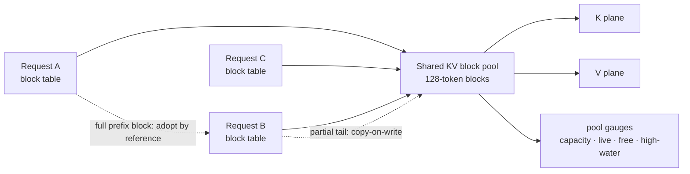
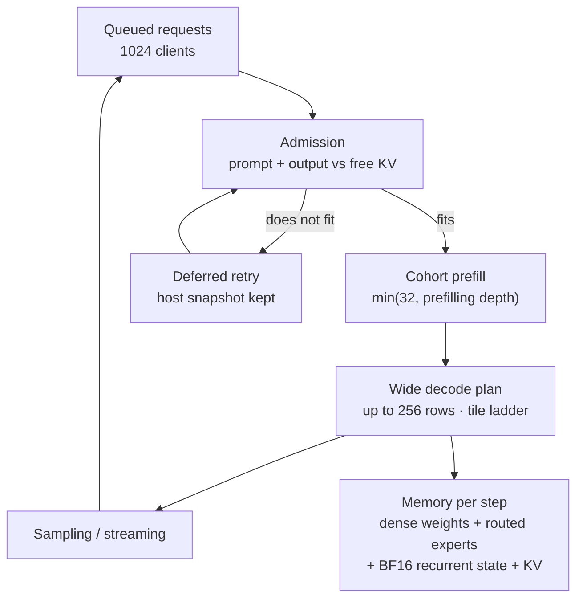
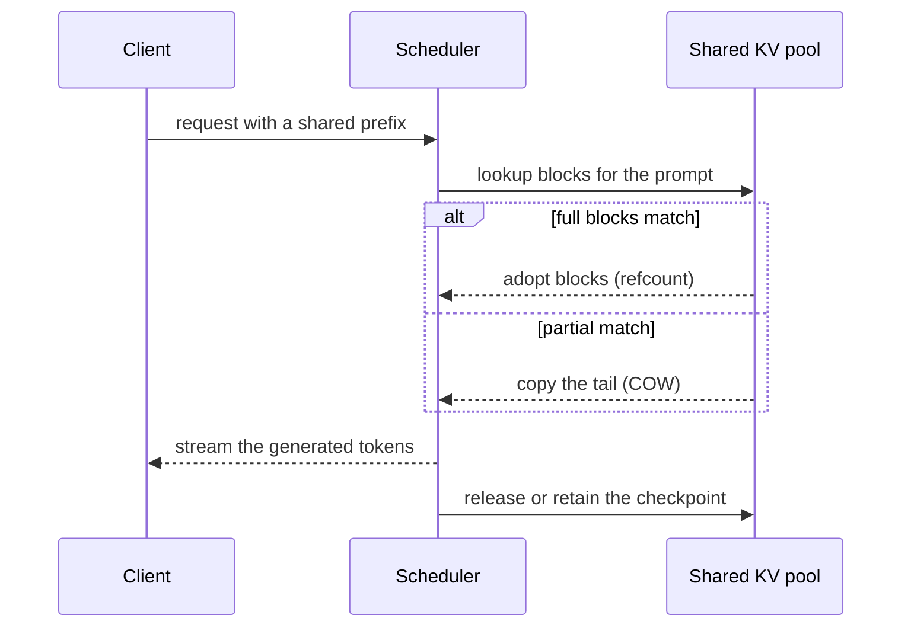
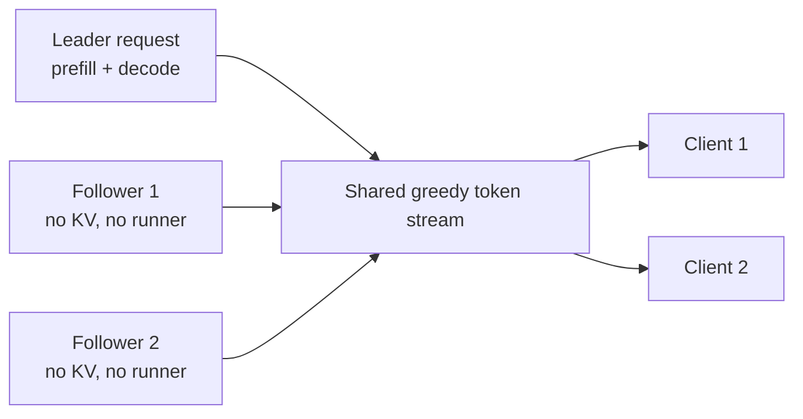
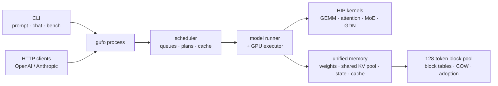

# Gufo: The ***Open Source*** Strix Halo AI engine

<p align="center">
  
</p>

Gufo is a vertical local inference engine for Linux and Windows, built and
optimized for AMD Strix Halo hardware: Ryzen AI MAX+ 395 systems with a Radeon
8060S (`gfx1151`) and up to 128 GiB of unified memory.

This README is the feature-focused guide for this tree. It explains what was
added over upstream Gufo 0.28.0, why each change matters for the two design
goals — a **shared KV cache pool** and the **highest possible total throughput
in batch serving** — and records the measured concurrency curve.

> **License unchanged.** Gufo's original code remains MIT licensed; see
> [License](#license). Adapted code and dependencies keep their own notices.

**New here?** Jump to the [quickstart](#quickstart), the
[benchmark](#concurrency-benchmark), the [feature map](#what-is-new-over-original-gufo),
or the complete [documentation index](docs/README.md). The detailed feature
inventory with per-feature evidence is [docs/FEATURES.md](docs/FEATURES.md).

## The two design goals

### 1. A shared KV cache pool

The KV cache is the part of serving that grows with concurrency and context. A
private contiguous KV plane per session makes memory scale as
`sessions x context x bytes_per_token`, even when most conversations are short.
Gufo instead places K/V rows in one pool of **128-token blocks**. Each request
owns a logical-to-physical **block table**; full blocks can be shared and
adopted by reference, and only the partial tail is copied on write.

That changes the memory question from "how much context can each session
reserve?" to "how many blocks are actually touched right now?". It is the
foundation for prefix reuse, host checkpoints, lazy mapping and the
`--kv-pool-bytes` budget.



### 2. Maximum total throughput in batch serving

On Strix Halo the decode step is memory-bandwidth bound. The throughput lever
is therefore **how many useful rows share one weight read**: a wider decode
cohort amortises the dense projections and expert weights, while a batched
prefill cohort amortises the fixed expert sweep over many prompt tokens. The
scheduler, the paged pool and the kernels are designed around that trade:

- keep the resident pool as large as the measured base state allows,
- fill the widest decode plan the cohort can supply,
- reuse the same weight block across as many token rows as possible,
- overlap cache work with admission instead of blocking the next wave.



## What is new over original Gufo

Upstream Gufo 0.28.0 already provides batched decode and admission, the
component cache, prefix checkpoint/reuse, MTP/DFlash2/DSpark speculation, the
OpenAI-compatible API and the model coverage in the table below. This tree adds
or changes the following features. Each row names its effect on the shared KV
pool and on batch throughput; the sections below explain the mechanism.

| Area | Feature | Shared KV pool | Total batch throughput |
| --- | --- | --- | --- |
| Serving | Recompute preemption | Returns KV to the pool without a swap buffer | Keeps the batch full instead of parking a request |
| Serving | Dynamic prefill budget | Each chunk is sized to free blocks | A long prompt cannot overrun the pool or starve decoders |
| Serving | Cohort prefill (default on) | One pass serves many requests' blocks | Amortises the expert sweep over more prompt tokens |
| Serving | Decode tile ladder + 8k+1 hold-back | No change | Removes the 9/17/25/33-row weight-read dips |
| Serving | Wide decode plans up to 256 rows | More sessions active per pass | Amortises dense and expert weights over a full cohort |
| Serving | `--sessions auto` | Sizes the pool from base state, not full context | Scales the plan with the resolved session count |
| Serving | Request coalescing (opt-in) | Followers hold no KV or runner request | 9.08x on byte-identical greedy duplicates |
| Serving | Watchdog and HTTP burst scaling | No change | Keeps a full burst from stalling or resetting |
| Cache | Paged attention and shared block pool | Replaces private KV planes with block tables | Fits more active sessions in the same memory |
| Cache | Block adoption and copy-on-write | Full blocks shared by reference; tails copied | Avoids duplicate prefill and copy work for shared prefixes |
| Cache | Prefix-cache hit-rate metrics | Makes reuse visible per request and globally | Lets throughput work target real cache value |
| Cache | Paged row-address hoisting | Resolves a block base once for K and V | Removes paging overhead from prefill |
| Cache | Lazy mapping + `--kv-pool-bytes` | Charges only written blocks | Frees device memory for more sessions |
| Cache | KV pool gauges | Capacity, live, free and high-water blocks | Makes the reservation verifiable |
| Cache | KV exhaustion degradation | Keeps the prefilled state as a host snapshot | Completes a tight-pool round instead of failing requests |
| Cache | Retention gating (`--cache-retain-cold`) | Does not retain unique cold prompts | Leaves RAM and backing for reusable state |
| Cache | Shared host-snapshot counters | Proves cross-request snapshot dedup | Avoids duplicating the same prefix in host RAM |
| State | BF16 recurrent SSM state | Halves the per-session state next to KV | More sessions fit in the same device memory |
| Decode | Compacted MoE dispatch for wide plans | No direct KV change | Reads each hot expert once per bucket, not per eight-token group |
| Decode | Wide expert tiles (64/128 rows) | No change | Reuses expert weights over more decode rows |
| Decode | Vectorised BF16 GDN state writeback | No change | Four 16-byte stores replace 32 scalar stores |
| Decode | Wide Q8 projections on W8A8/F16 route | No change | Reads each Q8 weight block once per wider activation tile |
| API | Model alias fallback | The loaded model stays resident; clients reuse the same pool | Avoids reloads that would drop the pool |
| API | Stop-sequence and text-span hardening | No KV change | Keeps a stream from derailing mid-batch |
| API | Artifact validator hardening | No KV change | Keeps measurement runs from aborting |
| Diagnostics | `gufo diagnose` power-profile check | Reports pool and clock state | Makes measurements comparable |
| Tooling | `gather_bw.hip`, paging/FP8 benches, serving sweep | Reproducible pool and bandwidth experiments | Finds the batch knee without a bespoke harness |
| Observability | Prometheus `/metrics` and Grafana dashboard | Exposes pool, cache, queue and session state | Correlates throughput with queueing and KV pressure |
| Docs | Architecture, KV visual, N-LEVERS, 52-measure catalog | Explains the pool and its invariants | Records retained/rejected throughput levers |

## Shared KV cache pool

### Paged attention and block tables

KV rows live in one pool of 128-token blocks. A request maps logical positions
to physical blocks through its own table; the executor reads K and V through
that table. Blocks are allocated on write, so a short conversation never holds
its full context.

Prefill attention also resolves a block's base once per key block and reuses
it for the K and V passes; the measured dense paging overhead fell from 22.6 %
to 2-4 %.

**Why it matters for the shared pool:** the pool is the single owner of KV
memory; block tables are small and per request. **Why it matters for
throughput:** the same device memory holds more active sessions, and a shared
prefix costs one physical copy instead of one per request.

### Block adoption, copy-on-write and the free list

Full blocks are immutable and can be adopted by reference
(`KvBlockTable::Adopt`). The partial tail below 128 tokens is copied into a
private block and written copy-on-write. `BeforeWrite` invalidates share
records before any mutation; a restore re-maps the table so an adopted block
cannot leak into a later request. The free list is a FIFO/LRU ring, so the
oldest free block is reused instead of the most recently released one.

**Why it matters for the shared pool:** full prefix blocks are shared without a
copy, while the writable tail stays private. **Why it matters for throughput:**
a shared-prefix cohort skips repeated prefill and keeps more sessions resident.



### Prefix cache, retention gate and host snapshots

The component cache retains checkpoints at stable boundaries and reuses them
when a later prompt has an exact prefix. `--cache-ram-bytes` sets the RAM
budget, `--cache-disk` persists selected checkpoints, and `--cache-retain-cold`
opts unique single-turn prompts into retention. Without that flag the
`ColdRetentionGate` keeps a prompt only when there is reuse evidence: a hit, a
waiting peer sharing the prefix, or a repeated/extended prompt. A measured
cold-only run kept 0.35 MB of ledger instead of 935 MB. `cache_shared_bytes`
and `retained_payload_bytes` expose how much came from a shared host snapshot
instead of a private copy.

**Why it matters for the shared pool:** retained checkpoints and shared host
snapshots are the cross-request form of the same pool; they make prefix reuse
possible after a request ends. **Why it matters for throughput:** a shared
prefix turns a full prefill into a restore, and the retention gate keeps RAM
available for traffic that can actually reuse it.

### Lazy mapping, `--kv-pool-bytes` and gauges

A session maps blocks on write (`EnsureKvCapacity`), not the whole context at
start. `--kv-pool-bytes N|off` caps the pool: the default derives it from free
device memory with a reserve, capped at `sessions x context`; `off` keeps one
full-context session as the floor. `KvPoolSnapshot` and the
`kv_blocks_shared` log line report capacity, live, free and high-water blocks
(also under `usage.gufo.component_cache.global_kv_pool`).

**Why it matters for the shared pool:** the reservation is explicit and
observable, and short conversations do not reserve their full context. **Why
it matters for throughput:** the freed device memory raises the session count
and the decode cohort width.

### KV exhaustion, host snapshots and metrics

If a request cannot get device KV blocks, the scheduler keeps its completed
prefill as a host snapshot, releases device state, and retries admission after
residents finish. Per request, `cached_tokens` and `cache_hit_rate` report
reuse; globally `gufo_prefix_cache_hits_total`,
`gufo_prefix_cache_misses_total` and `gufo_prefix_cache_hit_rate` expose the
same values, with the legacy `llamacpp:*` families retained. A 700 MB pool
under a 16-session load completed 32/32 requests with 37 degradations and no
device loss. Request outcomes, TTFT/duration histograms, session occupancy,
KV pressure and memory are documented in
[Prometheus metrics](docs/PROMETHEUS.md) and
[Grafana dashboard](docs/GRAFANA.md).

**Why it matters for the shared pool:** a tight pool costs latency, not
correctness; the snapshot preserves the prefilled prefix. **Why it matters for
throughput:** the round still completes, and the hit-rate metrics show whether
cache work is paying for itself.

### BF16 recurrent state

Flash-Next's linear layers keep the recurrent state in BF16 while the
delta-rule recurrence runs in F32. Device state per session drops from
113,246,208 B to 56,623,104 B (-56.6 MB, -50 %). Rollback snapshots stay F32
because they are read once per restore.

**Why it matters for the shared pool:** the recurrent state competes with KV
for the session budget; halving it allows more sessions or longer contexts.
**Why it matters for throughput:** more resident sessions fill a wider decode
plan.

### Explored, not adopted

An FP8 (E4M3) KV prototype halves KV bytes (2048 -> 1040 B/token) with cosine
0.9996, but costs 1.6-3.1x attention time on gfx1151 because E4M3 has no native
MMA path. It stays outside the serving path. The 32-token block experiment
also lost to 128-token blocks because paging overhead grew faster than the
fragmentation gain.

## Maximum total throughput in batch serving

### Continuous batching and recompute preemption

The scheduler admits new requests between decode steps and gives every due
decoder one target token per iteration. Preemption uses recompute, not swap:
generated tokens are appended to the prompt, the sampler state is carried
over, and the request is re-admitted ahead of new arrivals. Released KV goes
back to the pool. `preemptions` and `recompute_tokens` report the work.

**Why it matters for the shared pool:** preemption returns blocks to the pool
without reserving a host swap area. **Why it matters for throughput:** the
batch stays full and new demand can join the next wave.

### Dynamic prefill budget and cohort prefill

`--prefill-chunk` is an upper bound. The scheduler shrinks the actual pass to
what the free KV pool can hold, and admission charges each request's prompt
plus requested output against the pool. Cold prompts share a prefill pass:
the cap is `min(32, prefilling queue depth)`, and the stable-prefix chunk
boundary keeps the deterministic 256-prompt gate exact at cohort 8/16/32.
`GUFO_PREFILL_COHORT` overrides the cap for experiments;
`GUFO_BATCHED_PREFILL=0` is a diagnostics kill switch.

**Why it matters for the shared pool:** a pass never overruns the pool, and a
cohort's blocks are charged together. **Why it matters for throughput:** the
fixed expert sweep is amortised over more prompt tokens; the measured
1024-request prefill path is the difference between 416 s serial and the
cohort result in the benchmark below.

### Decode tile ladder and the 8k+1 hold-back

Decode projections use the MMVQ dispatcher's 1-32 row waves and the
16/32/48-token matrix tile. When the ready-row count is `8k+1`, the scheduler
holds one row back so the pass runs a full tile and the next wave absorbs the
tail. The measured 9/17/25/33-row dips disappear.

**Why it matters for throughput:** each weight block is reused across a full
tile instead of being re-read for a one-row tail.

### Wide decode plans up to 256 rows

Flash-Next advertises batched plans from two to 256 rows
(`kMaxBatchSessions`). Auto sessions fill the decode cohort up to the resolved
session count, hard-capped at 64; fixed pools can advertise wider plans up to
256 rows. Dense,
attention and shared-expert work uses the full plan; wide plans use the
compacted expert buckets, while narrow tails keep the grouped vector path.
`GUFO_DECODE_MAX_ROWS` and `GUFO_ASSEMBLE_DECODE_ROWS` are A/B overrides.

**Why it matters for the shared pool:** a wider cohort keeps more sessions in
one physical pass. **Why it matters for throughput:** it amortises the dense
projections and expert weights over more rows. The trade is lower per-stream
decode rate for higher aggregate throughput.

### Auto sessions: capacity, not a fixed resident count

`--sessions auto` resolves the pool after the model is resident. It divides
measured free state capacity by the per-session base state (block table,
indexer and recurrent state, not the shared KV rows) and keeps a 25 % reserve
for cache backing, transfer streams and allocator fragmentation. The uncapped
base-state fit on this host is **96 sessions at 250k** and **150 at 128k**;
autoscaling is hard-capped at **64 sessions**, and
`GUFO_AUTO_SESSIONS_MAX` can only lower that ceiling. The scheduler starts with
**one resident session**, grows toward visible demand, and returns to one when
idle. An admission that does not fit the shared pool stays queued and retries;
it is not failed.

The 96 are the state-capacity result for a 250k context: per-session base state
is ~304 MB (dominated by the ~217 MB indexer cache at 250k, plus 56.6 MB BF16
recurrent state and conv/PLE/control), and 25 % of the ~36.4 GiB free state
capacity is reserved. Without the reserve the same host fits 128 sessions. The
shared KV pool is a separate admission constraint; 96 session slots do not
mean 96 full-context conversations.

**Why it matters for the shared pool:** the pool is sized from base state, not
from `sessions x full context`, and admission charges the actual request.
**Why it matters for throughput:** the decoded plan scales with the resolved
pool, while a single-user server still pays for only one resident session.

### Request coalescing (opt-in)

`GUFO_REQUEST_COALESCE=1` lets byte-identical greedy requests share one model
session: the leader prefills and decodes, followers receive the same token
stream. Followers hold no runner request or KV. The measured 32-identical
batch is **9.08x** faster in wall/output terms; the canonical unique-nonce
benchmark does not trigger it.

**Why it matters for the shared pool:** duplicate requests consume no extra
blocks. **Why it matters for throughput:** exact duplicate batch traffic is
served at a fraction of the work.



### Compacted MoE dispatch for wide plans

Upstream's decode expert path uses grouped vector kernels. This tree sends wide
plans (>32 rows) through the compacted expert-matrix route: assignments are
bucketed by expert and read with 64-row down and 128-row gate/up tiles. The
deferred WMMA epilogue is settled before the batch combine. In the 256-row
benchmark routing collapses onto the same ten experts, so the old eight-token
groups read each hot expert many times; the compacted route reads it once per
bucket.

Measured 1024x16: **210.2 -> 177.0 s, 78.0 -> 92.6 TG, 462 -> 549 PP**;
256x128: **103.5 -> 81.0 s, 114.3 -> 145.8 TG**; 256/256 exact.

**Why it matters for the shared pool:** wide cohorts are practical because
their expert weights are not re-read per small group. **Why it matters for
throughput:** it is the largest single decode lever found in this work.

### Wide expert tiles and Q8 projections

Wide decode uses 64-row down-projection tiles and 128-row paired gate/up tiles
instead of 16-row decode tiles. On the Q8 side, `DenseBatch` sends Q8_0 rows
above 48 through the W8A8/F16 `Dense` route, so each Q8 weight block is read
once per wider activation tile instead of once per 32 rows; the 151k x 2560
vocabulary head is the largest case. Rows up to 48 keep the MMVQ tiles.

Measured 1024x16: wide tiles **176.28 -> 174.59 s**; wide Q8 **155.4 ->
145.3 s, 6.59 -> 7.05 requests/s, 105.4 -> 112.8 TG**. At 256x128 the Q8
route moves **64.1 -> 57.1 s, 184.3 -> 208.0 TG**; at 64 rows it is neutral
per token. Both changes pass the 256-prompt gate.

**Why it matters for the shared pool:** more of the device memory budget goes
to state and KV instead of repeated weight traffic. **Why it matters for
throughput:** the decode step is weight-bandwidth bound; wider reuse is a
direct gain.

### GDN state writeback

The BF16 recurrent state was written as 32 scalar two-byte stores per thread
at a 64-byte lane stride. It is now packed as eight BF16 values with the same
round-to-nearest-even encoding into one 16-byte `uint4`, so the writeback
emits four `global_store_b128` instead of 32 `global_store_d16`.

Measured 1024x16: **174.78 -> 156.48 s, 93.75 -> 104.7 TG, 555.6 -> 621.1
PP**; 256x16: **43.71 -> 39.52 s**. The change affects store width only and is
256/256 exact.

**Why it matters for the shared pool:** the recurrent state is per-session
state that competes with KV; less write traffic makes the session budget
cheaper. **Why it matters for throughput:** after the expert fix it was the
dominant per-step traffic.

### Operational guards

The HTTP listener uses a 1024-entry backlog floor, drains the accept queue in
a loop every 10 ms, and sizes the pending bound from `--max-connections` in
auto mode. `--stall-timeout-ms` defaults to 180000 ms: a device that stops
heartbeating is reported as `device_lost` instead of hanging.

**Why it matters for throughput:** a 256-client burst is accepted and admitted
instead of reset or rejected, and a wedged device becomes a restartable
failure.

### API, diagnostics and tooling

These do not change KV arithmetic, but they keep the measured serving path
reliable and the evidence reproducible:

- **Model alias fallback** resolves a missing or unknown `model` name to the
  loaded model, so a client cannot trigger a reload that would drop the
  resident pool. Known aliases are still echoed.
- **Stop-sequence and text-span hardening** removes undefined behavior and
  lost spans from the output path, so a stream does not fail after its prefill
  and KV work was already paid.
- **Artifact-validator hardening** parses diagnostic artifacts with bounded
  integers and explicit type errors; a malformed artifact cannot abort a
  measurement run.
- **`gufo diagnose`** reports the DRM power profile and the GPU queue state.
  `high` is the reproducible baseline; `auto` includes DPM ramp-up and
  compositor work and is advisory only.
- **`tools/bench/gather_bw.hip`** measures sparse expert-block reads against
  the same byte count contiguously (231-232 GB/s for both), separating the
  gather pattern from the memory ceiling.
- **Paging and FP8 benches** (`kv_paging_bench.hip`, `kv_fp8_attention.hip`)
  keep cache-layout trade-offs reproducible; the serving sweep tool finds the
  session/chunk knee.
- **The 52-measure catalog** keeps the retained and rejected throughput
  decisions with their evidence; the **documentation validator** keeps the
  links, anchors and Mermaid diagrams valid in CI.

## Measured optimization results

The following are alternating 2x2 A/Bs at 4k context, 256 sessions, unique
prompts and cache off. Every adopted row is 256/256 on the deterministic
prompt gate.

| Workload | Before | After | Delta |
| --- | ---: | ---: | ---: |
| 1024x16, #28 wide MoE dispatch | 210.2 s / 78.0 TG / 462 PP | 177.0 s / 92.6 TG / 549 PP | -15.8 % wall, +18.7 % TG |
| 1024x16, #25 wide expert tiles | 176.28 s / 92.95 TG | 174.59 s / 93.85 TG | -1.0 % wall, +1.0 % TG |
| 1024x16, #51 GDN state writeback | 174.78 s / 93.75 TG / 555.6 PP | 156.48 s / 104.7 TG / 621.1 PP | -10.5 % wall, +11.7 % TG |
| 1024x16, #52 wide Q8 route | 155.4 s / 6.59 req/s / 105.4 TG | 145.3 s / 7.05 req/s / 112.8 TG | -6.5 % wall, +7.0 % req/s |
| 256x128, #28 | 103.5 s / 114.3 TG | 81.0 s / 145.8 TG | -21.7 % wall, +27.5 % TG |
| 256x128, #52 | 64.1 s / 184.3 TG | 57.1 s / 208.0 TG | -10.9 % wall, +12.8 % TG |

The shipped binary's latest 1024x16 run is **144.4 s / 7.09 requests/s /
113.5 TG / 673.2 PP**. The retained catalog with the full status of all 52
measures is [docs/BATCH-THROUGHPUT.md](docs/BATCH-THROUGHPUT.md).

## Concurrency benchmark

This is a completed benchmark run, not the live server log. The columns are:

- `conc` — concurrent requests,
- `pp/s req` and `tg/s req` — per-request prefill and decode token rates,
- `TTFT ms` — time to first token; most rows report 0, the row at concurrency
  29 shows an isolated 525 ms sample,
- `tot pp/s` and `tot tg/s` — aggregate prompt and generated token rates over
  the whole run,
- `req/s` — completed requests per second,
- `wall s` — wall time for the run,
- `fail` — failed requests, `cache` — cache hits.

The live server prints a 10 s interval table with `win pp/s` / `win tg/s`,
`adm` (newly accepted requests) and `done` (finished requests) counts and
`win s`; every row is the delta since the previous row, so idle rows report
zero rather than the run average.

```text
conc |  pp/s req  tg/s req  TTFT ms |  tot pp/s  tot tg/s   req/s  wall s  fail  cache
--------------------------------------------------------------------------------------
   1 |     683.2      29.9        0 |      75.7      26.5    0.21   38.67     0      0
   2 |     432.2      24.1        0 |     118.2      41.4    0.32   24.75     0      0
   3 |     403.5      21.4        0 |     137.1      47.9    0.37   21.38     0      0
   4 |     331.3      18.5        0 |     171.9      60.1    0.47   17.03     0      0
   5 |     286.4      16.9        0 |     195.1      68.2    0.53   18.77     0      0
   6 |     253.3      15.6        0 |     213.6      74.7    0.58   20.56     0      0
   7 |     218.6      14.3        0 |     227.1      79.5    0.62   22.55     0      0
   8 |     184.5      13.3        0 |     239.5      83.8    0.65   24.43     0      0
   9 |     198.4      13.4        0 |     238.5      83.5    0.65   27.60     0      0
  10 |     158.1      11.4        0 |     255.1      89.3    0.70   28.68     0      0
  11 |     141.1      11.0        0 |     267.3      93.6    0.73   30.09     0      0
  12 |     117.9      10.5        0 |     270.4      94.6    0.74   32.48     0      0
  13 |     109.1      10.0        0 |     277.8      97.2    0.76   34.24     0      0
  14 |      97.3       9.6        0 |     285.6     100.0    0.78   35.85     0      0
  15 |      88.5       9.2        0 |     291.1     101.9    0.80   37.69     0      0
  16 |      83.2       8.9        0 |     297.5     104.0    0.81   39.37     0      0
  17 |     108.5       8.8        0 |     297.8     104.2    0.81   41.78     0      0
  18 |      78.6       7.7        0 |     294.8     103.2    0.81   44.66     0      0
  19 |      70.7       7.4        0 |     296.2     103.6    0.81   46.95     0      0
  20 |      66.3       7.3        0 |     306.0     107.1    0.84   47.83     0      0
  21 |      62.2       7.0        0 |     307.4     107.5    0.84   50.02     0      0
  22 |      58.3       6.8        0 |     309.0     108.1    0.84   52.08     0      0
  23 |      57.8       6.7        0 |     317.3     111.1    0.87   53.01     0      0
  24 |      52.3       6.4        0 |     315.7     110.5    0.86   55.60     0      0
  25 |      78.9       6.4        0 |     320.8     112.3    0.88   57.00     0      0
  26 |      45.7       6.0        0 |     316.2     110.6    0.86   60.18     0      0
  27 |      48.6       5.9        0 |     322.9     113.0    0.88   61.19     0      0
  28 |      43.0       5.8        0 |     323.3     113.0    0.88   63.41     0      0
  29 |      42.4       5.6      525 |     326.5     114.2    0.89   65.02     0      0
  30 |      40.8       5.5        0 |     329.3     115.3    0.90   66.64     0      0
  31 |      38.8       5.4        0 |     331.6     116.0    0.91   68.41     0      0
  32 |      37.4       5.2        0 |     330.5     115.6    0.90   70.84     0      0
```

What the curve says:

- Request throughput rises from **0.21 req/s at concurrency 1 to 0.91 at
  concurrency 31** (0.90 at 32). Aggregate generated throughput rises from
  **26.5 to 116.0 tok/s** and the total prompt rate from 75.7 to 331.6 tok/s
  over the same range.
- Per-request decode falls from 29.9 to 5.2 tok/s as the cohort shares the
  device; that is the expected latency/throughput trade, not a regression in
  aggregate work.
- Wall time has its minimum at **17.03 s at concurrency 4** and then grows
  again; the request rate keeps rising because each round admits more work.
  The shortest wall time is not the highest-throughput round.
- There are **zero failures** and **zero cache hits** across the table. The
  run uses unique prompts and cache off, so it measures cold compute rather
  than prefix reuse. Shared-prefix workloads are measured separately in the
  [KV cache](docs/KV-CACHE.md) and [Flash-Next benchmarks](docs/models/qwen3.8-flash-next/BENCHMARKS.md).

## Architecture at a glance



The [architecture document](docs/ARCHITECTURE.md) covers the request
lifecycle, prefill/decode, MoE dataflow, memory tiers, coalescing and the
architecture decisions. The [visual KV guide](docs/KV-CACHE-VISUAL.md) shows
the block pool, page tables and copy-on-write in detail.

## Quickstart

### Container

```sh
podman pull ghcr.io/gufo-org/toolboxes/gufo-runtime:latest
podman run --rm \
  --userns=keep-id:uid=1000,gid=1000 \
  --security-opt label=disable \
  --device /dev/kfd \
  --device /dev/dri \
  --group-add keep-groups \
  --ulimit memlock=-1 \
  -p 8080:8080 \
  -v ./models:/models:ro \
  ghcr.io/gufo-org/toolboxes/gufo-runtime:latest \
  gufo serve --host 0.0.0.0 --port 8080 llm \
  --model /models/Qwen3.8-Flash-Next-GGUF/UD-Q4_K_XL/Qwen3.8-Flash-Next-UD-Q4_K_XL-00001-of-00004.gguf \
  --context 8192 \
  --sessions auto \
  --served-model-name qwen3.8-flash-next
```

Rootless Podman needs `crun` for `--group-add keep-groups`, and the host user
must be able to open `/dev/kfd` and `/dev/dri/renderD*` (usually through the
`render` and `video` groups). The current model files and exact revisions are
listed in the [model guides](docs/models/README.md).

### Native build

```sh
nix build
./result/bin/gufo diagnose
./result/bin/gufo serve llm --model /path/to/model.gguf
```

`gufo diagnose` checks the device, the driver, the GPU queues and the power
profile before a measurement. See [Build from source](#build-from-source) for
the non-Nix path and [BUILD-WINDOWS.md](BUILD-WINDOWS.md) for Windows.

### Models

All model documentation lives under [docs/models](docs/models/README.md). The
engine supports text, vision, speech, audio, image and video models; the text
paths in this README focus on the Qwen and DeepSeek families because they
exercise the shared KV pool and wide decode plans.

| Model | Modes | Guide | Benchmarks |
| --- | --- | --- | --- |
| Qwen3.8 27B | Q4/Q8, images, AR, DFlash2 | [guide](docs/models/qwen3.8-27b/README.md) | [benchmarks](docs/models/qwen3.8-27b/BENCHMARKS.md) |
| Qwen3.8 Flash-Next | Q4, images, AR, MTP | [guide](docs/models/qwen3.8-flash-next/README.md) | [benchmarks](docs/models/qwen3.8-flash-next/BENCHMARKS.md) |
| DeepSeek V4 Flash | AR, DSpark | [guide](docs/models/deepseek-v4-flash/README.md) | [benchmarks](docs/models/deepseek-v4-flash/BENCHMARKS.md) |
| Qwen3-ASR 1.7B | Speech recognition | [guide](docs/models/qwen3-asr/README.md) | [benchmarks](docs/models/qwen3-asr/BENCHMARKS.md) |
| EmbeddingGemma 2 | Text and image embeddings | [guide](docs/models/embeddinggemma-2/README.md) | [benchmarks](docs/models/embeddinggemma-2/BENCHMARKS.md) |
| Qwen3-TTS 1.7B | Speech synthesis and voice cloning | [guide](docs/models/qwen3-tts/README.md) | [benchmarks](docs/models/qwen3-tts/BENCHMARKS.md) |
| Qwen-Image-2.1 | BF16 image generation and editing | [guide](docs/models/qwen-image-2.1/README.md) | [benchmarks](docs/models/qwen-image-2.1/BENCHMARKS.md) |
| MiniMax H3 | BF16 text to video/audio | [guide](docs/models/minimax-h3/README.md) | [benchmarks](docs/models/minimax-h3/BENCHMARKS.md) |

## Commands and settings

| Command | Purpose |
| --- | --- |
| `gufo serve` | OpenAI/Anthropic-compatible HTTP server |
| `gufo prompt` | one-shot generation for scripts |
| `gufo chat` | interactive terminal chat |
| `gufo bench` | direct prompt/decode throughput |
| `gufo diagnose` | hardware, driver, queue and power-profile checks |
| `gufo eval` | evaluate a running OpenAI server |
| `gufo transcribe` | one-shot ASR |

Settings that matter for the two design goals:

| Setting | Flag / environment | Effect |
| --- | --- | --- |
| context per session | `--context N` | Long prompts or many sessions; Flash-Next above 262144 needs `--enable-yarn` |
| resident sessions | `--sessions N\|auto` | `auto` fits the pool from base state; fixed values cap the resident count |
| auto-session cap | `GUFO_AUTO_SESSIONS_MAX=N` | lower the hard 64-session autoscaling cap; the value may never raise it |
| prefill work unit | `--prefill-chunk N` | Larger units amortise expert reads; the scheduler also shrinks to free KV |
| RAM prefix cache | `--cache-ram-bytes N\|off` | Keep repeated/shared prefixes warm; `off` for cold benchmark runs |
| cold retention | `--cache-retain-cold` | Opt unique single-turn prompts into retention |
| disk cache | `--cache-disk DIR --cache-disk-bytes N` | Restart-safe continuation; one process per directory |
| KV pool | `--kv-pool-bytes N\|off` | Cap the shared block pool; `off` keeps one full-context session |
| sampling | `--temperature`, `--top-k`, `--top-p`, `--min-p`, `--seed`, penalties | Deterministic vs creative decoding |
| reasoning | `--think on\|off\|auto`, `--reasoning-effort`, `--preserve-thinking`, `--reasoning-budget` | Thinking tokens and context cost |
| speculation | `--speculative dflash2\|dspark\|mtp`, companion model, `--draft-tokens` | Decode latency; keep off for exact AR comparisons |
| request coalescing | `GUFO_REQUEST_COALESCE=1` | Byte-identical greedy requests share one stream |
| HTTP limits | `--max-connections`, `--max-pending`, `--max-pending-per-client` | Protect the machine from bursts |
| stall watchdog | `--stall-timeout-ms N` | Restart a wedged device instead of hanging |
| logging | `--log-level error\|warn\|info\|debug` | INFO prints the 10 s stats table and minute request line; DEBUG adds per-request, scheduler and cache detail |
| served name | `--served-model-name ID` | Client-facing model id |

Monitoring needs no flag: `GET /metrics` (alias `/v1/metrics`) exposes
Prometheus text for request outcomes, TTFT and duration, tokens, cache reuse,
sessions, KV pressure and memory. Scrape configuration and the complete metric
catalog are in [Prometheus metrics](docs/PROMETHEUS.md); the importable
dashboard and provisioning are in [Grafana dashboard](docs/GRAFANA.md).

Serving recipes:

```sh
# Throughput: wide decode, cache off, 4k context
gufo serve llm --model MODEL --context 4096 --sessions 256 --cache-ram-bytes off

# Long context: auto sessions resolve to the state-capacity fit, capped at 64
gufo serve llm --model MODEL --context 250000 --sessions auto

# Single-user latency: one session, optional MTP drafts
gufo serve llm --model MODEL --sessions 1 --speculative mtp --mtp-model DRAFT

# Shared prefixes: keep the RAM cache on and report output/TTFT
gufo serve llm --model MODEL --cache-ram-bytes auto
```

## Build from source

Production packages target Linux x86-64 on AMD Strix Halo (`gfx1151`). Windows
x86-64 is a supported native build target for development; see
[BUILD-WINDOWS.md](BUILD-WINDOWS.md). CMake owns one production configuration
for both Nix and ordinary Linux builds.

### With Nix

```sh
nix build
./result/bin/gufo diagnose
./result/bin/gufo serve llm --model /path/to/model.gguf
```

`nix develop` adds the profiling, model-download and evaluation tools. See
[testing](docs/TESTING.md) for the hosted checks and focused GPU suites.

### Without Nix

Install a C++20 compiler, CMake 3.21+, Ninja, pkg-config and the following
development libraries. The pinned Nix toolchain uses GCC 16.2 and ROCm 10.1.0
(HIP Clang 24). Python, Triton/AOTriton, Composable Kernel and MIOpen are not
production build or runtime requirements.

| Dependency | Used for |
| --- | --- |
| ROCm HIP compiler/runtime, hipBLAS, hipBLASLt, rocBLAS | GPU execution and matrix multiplication |
| hipCUB, rocPRIM, rocWMMA headers | Compiled GPU kernels |
| ICU, libcurl, OpenSSL, libpng, libjpeg, libwebp | Tokenization, HTTPS, hashing and images |
| FFmpeg development libraries | Video embedding decoding and RGB conversion |
| libsndfile, libsoxr | Audio decoding and reference-compatible resampling |
| FFmpeg and ffprobe | Video/audio output; invoked as separate executables |

Install ROCm with [AMD's Linux instructions](https://rocm.docs.amd.com/projects/install-on-linux/en/latest/).
For Debian/Ubuntu, the ordinary system libraries are:

```sh
sudo apt install build-essential cmake ninja-build pkg-config \
  libicu-dev libcurl4-openssl-dev libssl-dev libpng-dev libjpeg-dev \
  libwebp-dev libsndfile1-dev libsoxr-dev libavformat-dev libavcodec-dev \
  libavutil-dev libswscale-dev ffmpeg
sudo apt install hipblas-dev hipblaslt-dev rocblas-dev \
  hipcub-dev rocprim-dev rocwmma-dev

cmake --preset release -DCMAKE_INSTALL_PREFIX="$HOME/.local"
cmake --build --preset release --parallel 4
./build/release/gufo diagnose
./build/release/gufo serve llm --model /path/to/model.gguf
```

Configuring fails at `find_package(hipblas)` when the ROCm packages are
missing. For nonstandard installations pass
`-DCMAKE_PREFIX_PATH="/opt/rocm"`, and if compiler discovery picks a system
Clang also pass `-DCMAKE_HIP_COMPILER=/opt/rocm/llvm/bin/clang++`. The GPU
driver must allow the user to open `/dev/kfd` and `/dev/dri`; model weights are
acquired separately from their publishers.

## Documentation

- [Documentation index](docs/README.md)
- [Features added over upstream Gufo](docs/FEATURES.md) — every feature with
  purpose, usage and evidence
- [Architecture](docs/ARCHITECTURE.md) — request flow, prefill/decode, MoE,
  cache tiers, coalescing and ADRs
- [KV cache](docs/KV-CACHE.md) and [visual KV/pagination](docs/KV-CACHE-VISUAL.md)
- [Batch throughput](docs/BATCH-THROUGHPUT.md) — 52 measures with retained and
  rejected status
- [Server contract](docs/SERVER.md) and [CLI guide](docs/CLI.md)
- [Prometheus metrics](docs/PROMETHEUS.md) and
  [Grafana dashboard](docs/GRAFANA.md)
- [Benchmark methodology](docs/BENCHMARKS.md) and
  [performance loop](docs/PERFORMANCE.md)
- [Progress log](PROGRESS.md) — chronological engineering record with rejected
  alternatives

## License

Gufo's original code is [MIT licensed](LICENSE). Adapted code and dependencies
retain their own notices in [NOTICE](NOTICE),
[THIRD_PARTY_NOTICES.md](THIRD_PARTY_NOTICES.md) and `licenses/`, installed
under `share/licenses/gufo`. Model weights are not bundled and retain their
publishers' terms.

## Reference projects

The initial design is informed by:

- [llama.cpp](https://github.com/ggml-org/llama.cpp) for compact model serving,
  GGUF, and CPU/GPU correctness paths.
- [LaurentZuijdwijk/llama.cpp](https://github.com/LaurentZuijdwijk/llama.cpp),
  [Nathanw1014/strix-halo-llamacpp](https://github.com/Nathanw1014/strix-halo-llamacpp)
  and [gaetan-puleo/llama-cpp-strix-halo](https://github.com/gaetan-puleo/llama-cpp-strix-halo)
  for Strix Halo optimization inspiration.
- [vLLM](https://github.com/vllm-project/vllm) for continuous batching and
  paged request scheduling.
- [hipEngine](https://github.com/shisa-ai/hipEngine) for torch-free HIP
  execution and native speculative-cycle work.
- [ds4](https://github.com/antirez/ds4) for DeepSeek V4 Flash, MoE scheduling
  and DSpark.
- [audio.cpp](https://github.com/0xShug0/audio.cpp) for TTS and ASR audio
  models.
