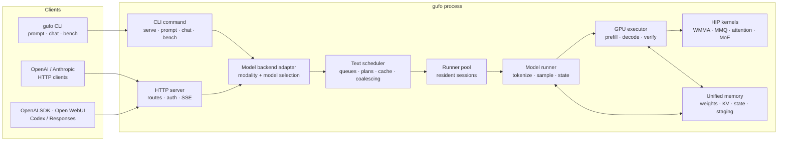
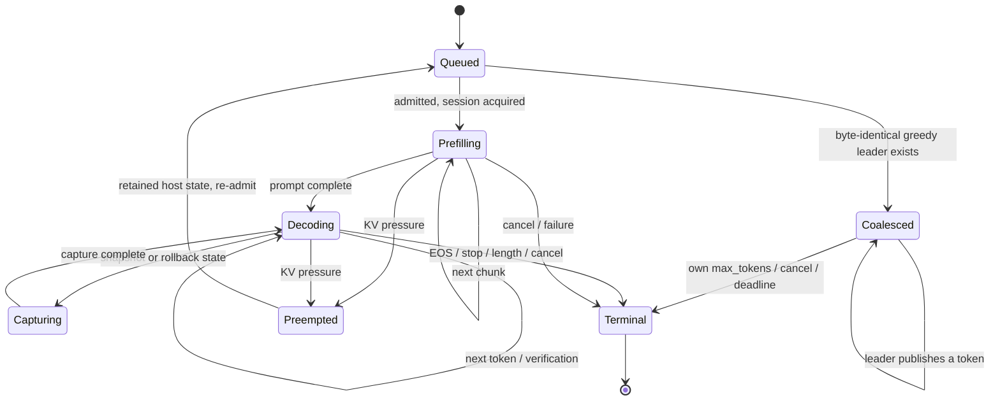
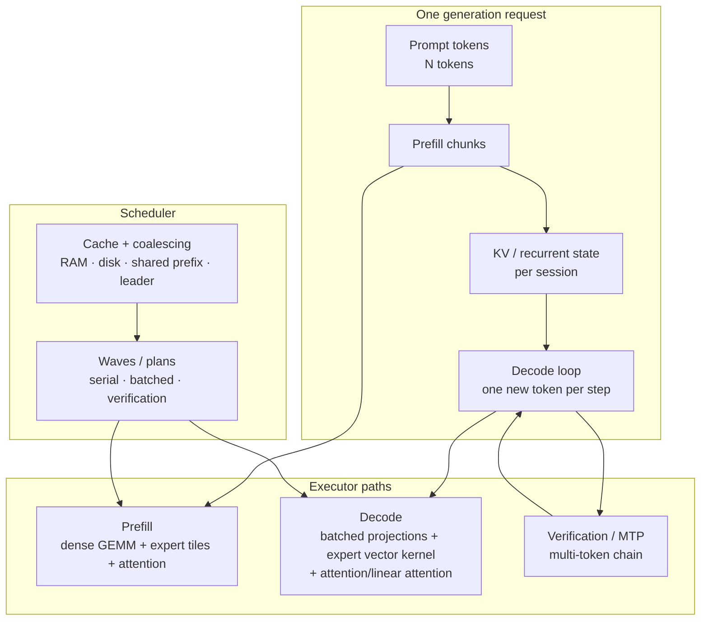
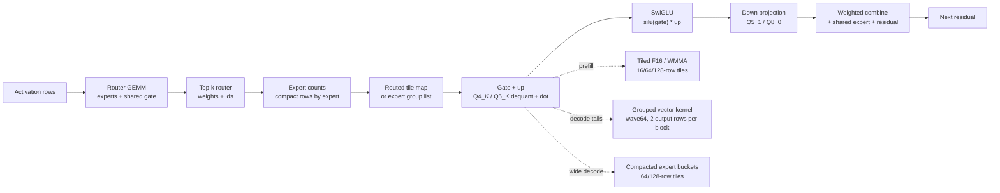
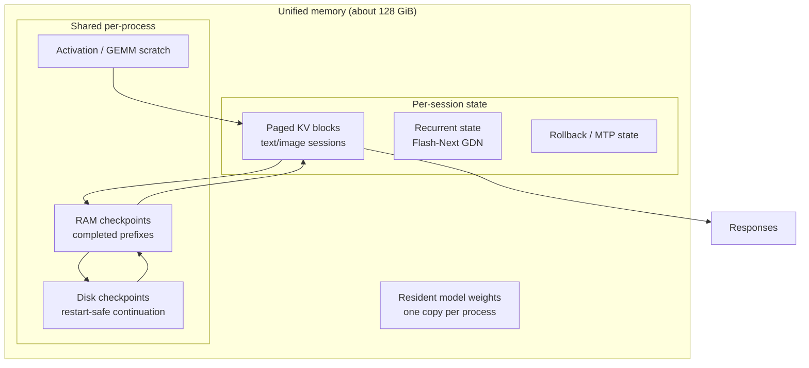
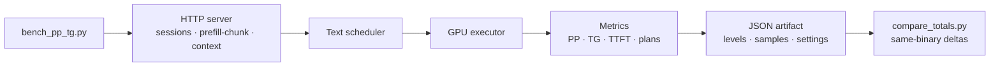

# Architecture

Gufo is one native executable that serves several model families on AMD
Strix Halo (`gfx1151`, unified memory). This document is the map: the process
and request flow, the GPU execution paths, the memory/cache hierarchy, request
coalescing, and the decisions behind them. Benchmarks and quality evidence live
in the model folders and in `docs/BENCHMARKS.md`; this file explains the design.

> **Quickstart:** see the [top-level README](../README.md#quickstart) and the
> [CLI guide](CLI.md). This document is for contributors and operators who need
> to know *why* a setting exists.

## 1. System at a glance



Everything runs in one process. The CLI and HTTP server share the same model
loaders, tokenizers, sampling code and GPU executors; the scheduler is the only
component that owns concurrent requests and the cache. A dedicated GPU process
is deliberately avoided: weights are resident once, and the scheduler can make
batch decisions with complete knowledge of every session.

## 2. Request lifecycle



The scheduler is single-threaded for model decisions. Submitters only enqueue;
the scheduler thread admits, selects a plan, calls the runner, publishes output
and handles cancellation. This removes lock contention from the hot path and
makes plan selection (batch width, cache, coalescing) a pure function of the
current sessions.

Key source files:

| concern | source |
| --- | --- |
| CLI entry points | `src/cli/main.cpp`, `src/cli/serve/serve.cpp` |
| HTTP routes/SSE | `src/cli/serve/http_server.cpp`, `openai_chat.cpp` |
| scheduler and queues | `src/cli/serve/text_generation_scheduler.cpp` |
| runner pool and requests | `src/cli/serve/text_model_runner.cpp` |
| model dispatch/capabilities | `src/cli/serve/inference_backend.cpp` |
| model executors | `src/models/*/kernels/rocm/`, `src/models/*/engine.cpp` |
| cache | `src/cache/`, `docs/KV-CACHE.md`, `docs/cache-redesign/` |
| diagnostics/platform | `src/core/diagnostics/`, `src/core/platform/` |

## 3. Prefill and decode



- **Prefill** runs one pass at a time. A pass pays the full expert-weight read
  plus a per-token part; short prompts are dominated by the fixed read. This is
  why a cold 336-token prompt is a large part of a serving round.
- **Decode** advances every resident session by one target token. The physical
  width is a plan (1..N); a wider plan amortises the expert read over more
  sessions but reduces per-request latency. For Qwen3.8 Flash-Next the
  scheduler advertises 2..256 rows and picks the widest plan the resident
  cohort can fill; 32 is the retained control point, 256 the best measured
  wide-batch point, and width 1 the latency point. Wide Q8 projections (the
  attention/SSM QKV and output projections, plus the vocabulary head) use the
  W8A8/F16 Dense route above 48 rows, so each weight block is read once per
  wider activation tile instead of once per 32 rows; rows up to 48 keep the
  MMVQ q8_1 tiles.
- **Verification / speculative decoding** adds a draft chain: the target
  verifies several rows in one forward pass, then commits the accepted prefix.
  Greedy verification must reproduce the autoregressive tokens; sampled
  verification preserves the target distribution but not a particular sampled
  sequence.

## 4. The mixture-of-experts path



Two expert GEMMs exist for a reason:

- **Prefill** has many rows per expert, so the tiled F16/WMMA path amortises
  dequantisation over a 16-row tile. Padding is acceptable because there is
  enough work per tile.
- **Decode** has two routes. Narrow tails (up to 32 rows) use the grouped
  vector kernel, which avoids padding and reuses each weight fragment across
  the slots of an expert. Wide plans (>32 rows) delegate to `Moe`: the routed
  assignments are compacted into expert buckets and read with the 64-row down
  and 128-row gate/up tiles. This matters because routing can concentrate on a
  few experts: with all 256 rows on the same ten experts, the vector route
  re-read each hot expert once per eight-token group, while the compacted route
  reads it once per bucket. The wide route took 1024x16 from 210.2 to 177.0 s
  and 256x128 from 103.5 to 81.0 s (2x2 A/B, 256/256 exact); the wider tiles
  added another ~1 % at 1024x16.

The shared expert is a dense gate/up/down pair. It is processed in eight-row
chunks on decode and can overlap the routed experts on the side stream for
wide batches; the measured decode overlap was neutral, so the sequential path
remains the default.

## 5. Memory and cache hierarchy



The block-level implementation is diagrammed in the [visual KV cache and
pagination guide](KV-CACHE-VISUAL.md).

The design separates three reuse tiers:

1. **Live session state** — a resident session keeps its KV/recurrent state;
   no copy is needed for the next token.
2. **RAM checkpoints** — completed prefixes are retained (subject to the
   `--cache-ram-bytes` budget) and restored into a new session. The component
   cache can share immutable blocks between sessions.
3. **Disk checkpoints** — `--cache-disk` persists selected checkpoints for
   restart-safe continuation. A directory is owned by one process.

The default RAM budget is `0` = auto (half of free RAM, up to 32 GiB); `off`
disables retained checkpoints but keeps each session's live state. The
canonical serving benchmark runs with `off` to measure cold compute. A
shared-prefix workload (or a repeated conversation) benefits from the default
cache; see `docs/KV-CACHE.md` and `docs/cache-redesign/RFC.md`. Cold, unique
single-turn prompts are not retained unless `--cache-retain-cold` opts in, so
one-off traffic cannot fill the RAM ledger. Flash-Next keeps the recurrent
state of its linear layers in BF16 (the recurrence itself runs in F32), which
halves the per-session state next to KV.

## 6. Request coalescing

```mermaid
sequenceDiagram
    autonumber
    participant L as Leader client
    participant F as Follower clients
    participant S as Scheduler
    participant M as Model runner
    participant P as Fan-out

    L->>S: Submit identical greedy prompt
    S->>M: Acquire session + prefill
    F->>S: Submit identical greedy prompt
    S->>S: Match prompt/sampling; no session
    Note over S: follower has no runner_request / KV
    M->>S: token t
    S->>L: publish token t
    S->>P: copy selection to followers
    P->>F: token t (own stream/metrics)
    Note over S: per-follower max_tokens, cancel, deadline
    M->>S: EOS / leader limit
    S->>L: terminal
    S->>F: terminal (same reason / own earlier limit)
```

Coalescing is opt-in with `GUFO_REQUEST_COALESCE=1`. It is valid only when the
requests are semantically the same stream: byte-identical prompt, greedy
sampling (`temperature=0`, no penalties, no logprobs, no constraints, no stop
sequences, no prompt-progress stream), identical `stop_at_eos` and
`cache_prompt`, and a follower token limit not exceeding the leader's. The
leader owns the only session; followers receive the leader's selections and
carry `prefill_tokens=0` because the prefill is shared. A late request that
arrives after the leader has published a token becomes its own leader, so it
cannot miss the prefix. Follower cancellation removes only that follower; a
leader cancellation/failure terminates the group (the current limitation).

Measured effect (32 identical requests, 128 greedy tokens): 44.410 s -> 4.891 s
(9.08x; an earlier 264-token prompt measured 47.753 s -> 5.009 s, 9.53x),
4096 identical output tokens. The canonical benchmark uses unique front-loaded
nonces, so it does not trigger coalescing; its on/off difference is noise and
the table is the control. Details: [N-LEVERS](models/qwen3.8-flash-next/N-LEVERS.md) and
[Flash-Next benchmarks](models/qwen3.8-flash-next/BENCHMARKS.md).

## 7. Benchmark and measurement flow



The serving benchmark deliberately gives every request a unique front-loaded
nonce and runs with the RAM cache off. That measures cold prefill and unique
decode rows, not cache/coalescing. Shared-prefix (`--shared-prefix`) and
identical-request workloads are measured separately; their scores must report
output throughput and TTFT, and the physical-token total has to be interpreted
carefully because a cache hit or a coalesced follower logs `prefill_tokens=0`.
The canonical 8/16/24/32 table and the latest on/off A/B live in
`docs/models/qwen3.8-flash-next/BENCHMARKS.md` and the
[N-LEVERS](models/qwen3.8-flash-next/N-LEVERS.md).

## 8. Architecture decisions

### ADR-1: One process, many resident sessions, one model stream

**Context.** The target is a single 128 GiB APU, not a multi-GPU node. Loading
weights once and sharing the HIP context is a large memory and startup win.

**Decision.** Keep one process per served checkpoint. The scheduler owns
resident sessions and serialises model work on the executor's stream; sessions
have private KV/recurrent state but share weights and scratch where the model
allows it.

**Consequences.** No inter-process weight duplication; plan selection can see
all sessions. A model crash takes the process down, so the stall watchdog and
`device_lost` path are part of the serving contract.

### ADR-2: Prefill one pass at a time, decode in a chosen physical width

**Context.** A prefill pass has a fixed 66 GB-class expert read for Flash-Next;
decode amortises the same read over the batch. Wider batches improve aggregate
decode but hurt per-request latency.

**Decision.** Prefill runs one pass at a time; several cold prompts share it in
the default cohort, whose stable-prefix chunk boundary passes the deterministic
256/256 gate at cohort 8/16/32 (`GUFO_BATCHED_PREFILL=0` is a diagnostics kill
switch). Decode plans are explicit widths; Flash-Next advertises 2..256 rows.
Auto sessions fill the decode cohort up to the resolved session count, so the
plan scales with the pool: 96 rows at 250k, 150 at 128k, 256 at short context.
Wide decode plans (>32 rows) use the compacted expert buckets; narrow tails keep
the grouped vector path. Width 32 remains the retained cold canonical control.

**Consequences.** The canonical c32 table is the throughput reference; c24
keeps more per-request rate. At 1024 concurrent requests with 32 output tokens,
256 rows measured 61.0 tok/s aggregate TG / 533.8 s against 56.8 tok/s / 574.0 s
for 32 rows (+7.4 % TG). A 16-output prefill-bound run was neutral (37.5 vs
37.4 tok/s); the gain is decode-workload dependent. Greedy token parity against
32 rows held for 256 deterministic prompts.

### ADR-3: Tiled expert GEMMs for prefill and wide decode, vector groups for tails

**Context.** Dequantising every weight element for one or two rows is wasteful;
padding a two-row bucket into a 16-row tile is also wasteful. But a wide decode
plan can route hundreds of rows to the same hot expert, where eight-token
vector groups re-read the expert's weights many times.

**Decision.** Keep both paths. Tiled F16/WMMA handles multi-row prefill. Decode
uses grouped vector kernels for narrow tails and delegates wide plans (>32
rows) to the compacted expert buckets (`Moe`), with 64-row down and 128-row
gate/up tiles. The prefill path also prefetches one stage ahead and pairs
gate/up with SwiGLU.

**Consequences.** The compacted route is the largest measured decode lever on
Flash-Next: 1024x16 improved from 210.2 to 177.0 s and 256x128 from 103.5 to
81.0 s (2x2 A/B), and the wide tiles added a further ~1 % at 1024x16. Narrow
tails keep the vector path because compaction would add work without weight
reuse. The remaining headroom is the recurrent-state traffic and the dense
trunk, not the routed expert read.

### ADR-4: Keep cold and shared-prefix measurements separate

**Context.** A cache hit or a coalesced follower legitimately skips work. A
single "tokens/s" number that counts only executed tokens will look lower even
when the user-visible latency and output rate improve.

**Decision.** The canonical benchmark runs cache-off with unique nonces. Cached
and coalesced workloads are separate measurements and report output throughput,
TTFT and wall time; physical-token totals are annotated.

**Consequences.** Comparisons are honest but require reading the workload
label. The shared-prefix cache measured 94.67 -> 119.94 output tok/s (+26.7%)
and 13.87 s -> 0.223 s TTFT, while its physical-token total fell because cached
prefill is zero.

### ADR-5: Coalescing only for exact duplicate greedy streams

**Context.** Sharing a decode stream is a large win for duplicate requests but
changes state ownership, cancellation and accounting.

**Decision.** Match only byte-identical prompts with greedy sampling and the
same stop/EOS/cache flags. The leader owns the session; followers have no
runner request, receive the token fan-out, and are finalized independently at
their own limit/stop/cancel. A follower is only admitted while the leader has
not published a token.

**Consequences.** The feature is safe and token-identical for its scope; the
canonical unique-nonce benchmark does not trigger it. Leader cancellation
terminates the group (no leader promotion yet); requests with stops, logprobs,
penalties or longer limits stay independent.

### ADR-6: Cache tiers, budgets and ownership

**Context.** Unified memory is shared by weights, sessions and caches; a
session's full KV cannot always stay resident.

**Decision.** Use live session state, a RAM checkpoint tier with an explicit
budget, and an opt-in disk tier owned by one process. The component cache shares
immutable blocks; session mutation and rollback are explicit.

**Consequences.** `--cache-ram-bytes off` is a real cold measurement, not a
no-op: sessions still reuse their own live state. A shared-prefix workload
should leave the cache at auto and use `--cache-disk` only when restart-safe
continuation is required. Details: `docs/KV-CACHE.md`.

### ADR-7: Diagnostics and power profile are part of the measurement contract

**Context.** Throughput numbers depend on clocks, the compositor and the power
profile; a silent `dpm=auto` can hide 5-10%.

**Decision.** `gufo diagnose` and `gufo serve` report the power profile;
`--stall-timeout-ms` turns a wedged device into a restartable `device_lost`
instead of an indefinite hold. Kernel benchmarks use the peak probe for
hardware ceilings.

**Consequences.** A throughput number without its profile is incomplete. The
profile write still needs host root; the runbook records the honest `auto`
baseline when it cannot be pinned.

### ADR-8: Auto sessions grow with demand and never fail on VRAM exhaustion

**Context.** A fixed session count forces the operator to choose between
latency and aggregate throughput before the workload is known. Long-context
servers cannot simply raise the count if every session reserves a full context:
that charges the maximum KV for every conversation, including the short ones
that dominate real traffic. A request that loses the KV race must not be
dropped.

**Decision.** `--sessions auto` resolves the pool after model load from the
runner's measured state capacity, divided by the per-session **base state**
(block table, index and recurrent state) and a 25 % reserve for cache backing,
transfer streams and allocator fragmentation. The shared paged-KV rows are not
charged per session. The count is not capped by the widest execution plan; a
wider pool serves additional sessions in later decode waves. Admission charges
each request's prompt plus its requested output budget against the shared pool's
free blocks and outstanding reservations; a request that does not fit stays
queued and retries after 20 ms. The scheduler starts at one resident session
and grows toward visible demand. In auto mode, KV exhaustion defers a request
with its retained host snapshot and retries it; the fixed-mode deferral limit,
snapshot-pending refusal and patience timeout do not apply. Auto servers
disable device-row lending for prefix-cache checkpoints so completed requests
cannot pin pool blocks.

**Consequences.** A single-user server stays at one session; a burst expands to
the memory-and-demand limit and contracts when idle. On this host Flash-Next
resolves to 150 sessions at 128k and 96 at 250k, so the hybrid plan reaches
150 or 96 rows instead of the former 32-row control. The effective count
appears as `sessions=auto(N)` and `event=auto_sessions`. The trade-off is bounded latency: a request that exceeds
the current free KV waits for residents to release blocks instead of returning
an error. Queue-full admission (`--max-pending`) and non-KV errors still fail
fast. Non-text modalities keep their own fixed queues.

## 9. Invariants and limits

- The model's weights are resident once; a second server for the same model
  duplicates them. Two Flash-Next servers do not fit in 128 GiB.
- A scheduler decision is made on one thread; don't add blocking GPU calls to
  plan selection.
- Prefill is one pass at a time. The default cohort uses a stable-prefix chunk
  boundary and passes the deterministic 256/256 gate at cohort 8/16/32;
  `GUFO_BATCHED_PREFILL=0` is a diagnostics kill switch.
- A decode plan width is physical rows, not request count. Two 16-row waves are
  not a 32-row plan, and two 128-row waves are not a 256-row plan.
- Any cache hit, coalesced follower or shared prefill must be reported with its
  workload label; physical-token totals can decrease while output/wall
  improves.
- The canonical benchmark is a cold, unique-prompt workload. Do not use it to
  claim a cache/coalescing speedup.

## 10. Where to go next

- [README quickstart](../README.md#quickstart) — build, serve, prompt, bench.
- [CLI guide](CLI.md) — command and setting reference.
- [Server contract](SERVER.md) — HTTP endpoints, caching, limits.
- [KV cache](KV-CACHE.md) and [cache redesign](cache-redesign/RFC.md).
- [Benchmark methodology](BENCHMARKS.md) and [performance loop](PERFORMANCE.md).
- [Models](models/README.md) — per-model weights, modes, quality and retained
  benchmark tables.
- [Testing](TESTING.md), [CI](CI.md), [development](DEVELOPMENT.md) and
  [releasing](RELEASING.md).
