# Shared KV cache and pagination — visual implementation guide

> Companion to the [KV cache guide](KV-CACHE.md), the [paged KV
> design](cache-redesign/paged-kv.md), the [cache redesign
> RFC](cache-redesign/RFC.md) and the [architecture](ARCHITECTURE.md). This
> page is the diagram-first view of how the shared device KV pool, the
> per-session page tables and the host-side checkpoint cache fit together.

The important distinction is that Gufo has **two layers of reuse**:

1. **Attention KV inside one request** — the full-attention K/V rows are written
   into a shared, paged device pool as the request prefills and decodes.
2. **Checkpoints across requests** — an opaque model snapshot (including those
   K/V rows and all private recurrent/indexer state) is retained and restored
   for an exact prompt prefix.

Pagination belongs to layer 1. Prefix reuse belongs to layer 2. They meet at
the point where a restored checkpoint adopts full KV blocks by reference
instead of copying their rows.

## 1. The two layers at a glance

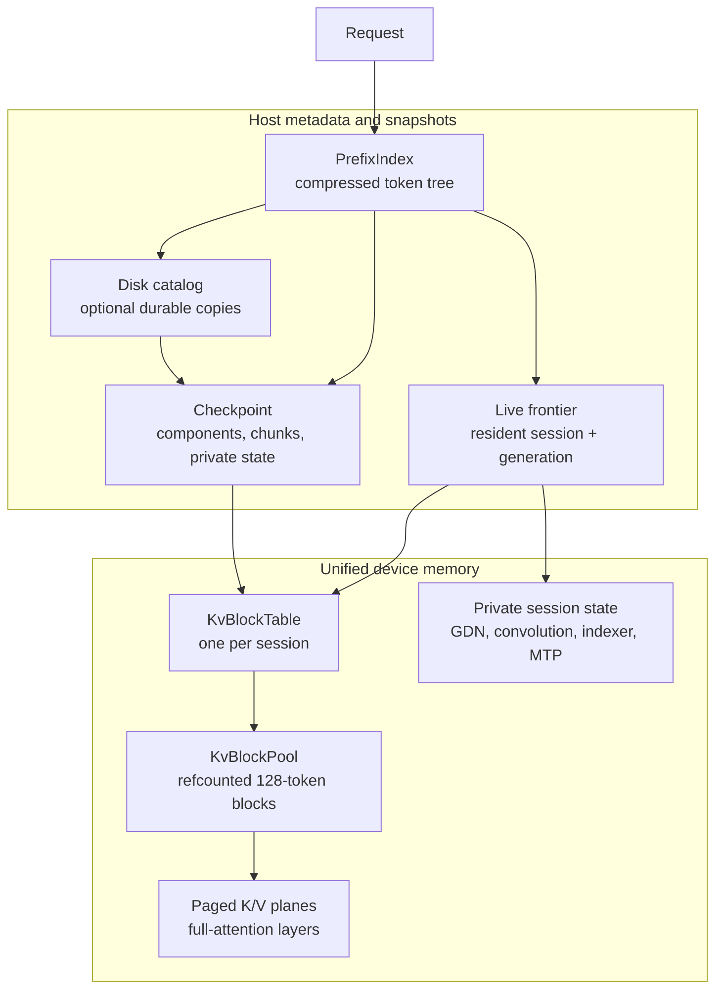

- `PrefixIndex` selects a live frontier, a RAM checkpoint, or a durable
  checkpoint. Selection is exact-prefix only.
- A live frontier is already in a session; reusing it takes no restore copy.
- A checkpoint restore fills a free session and may adopt full KV blocks by
  reference.
- `KvBlockPool` owns block ids and reference counts. It never owns bytes; the
  model executor owns the single device allocation for both K/V planes.
- `PRIV` is deliberately outside the paged pool. Flash-Next's 36 linear (GDN)
  layers keep O(1) recurrent/convolution state per session; the indexer and MTP
  draft ring are private too.

## 2. Page geometry

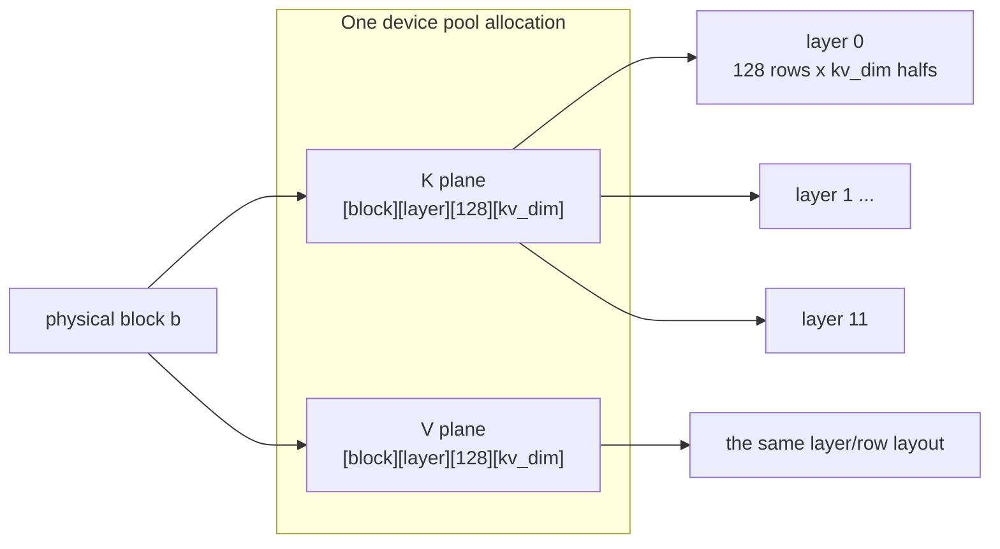

One block covers **all full-attention layers and both planes**:

```text
block_tokens = 128                 // kKvBlockTokens, shift 7
invalid_id   = 0xFFFFFFFF          // kInvalidKvBlock

block_bytes = 2 planes
            * block_tokens
            * attention_layers
            * kv_dim
            * sizeof(half)

Flash-Next: 2 * 128 * 12 * 512 * 2 = 3,145,728 bytes = 3 MiB
```

`kv_dim = num_kv_heads * head_dim` (Flash-Next: `2 * 256 = 512`). The 27B
model uses the same formula with its own layer count and KV width. At 24 KiB
per token for Flash-Next AR, 128 tokens are 3 MiB; speculative mode duplicates
the draft ring and is 48 KiB per token.

The design consequence is simple: a session needs **one table**, not one table
per layer, because every full-attention layer and both planes have the same
geometry.

## 3. Logical positions to physical blocks

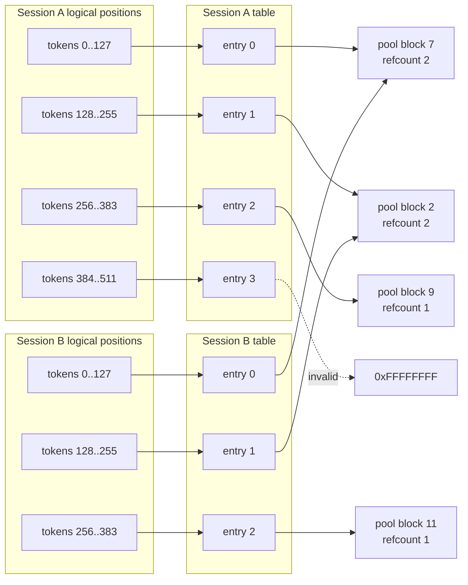

Sessions A and B share blocks 7 and 2 because their first 256 tokens are
identical. They diverge at token 256: B writes block 11 while A keeps block 9.
A checkpoint that references block 7 adds **one more reference**; the block is
returned to the free list only when the live table, every checkpoint and every
reader/persistence pin release it.

The table shape is fixed at session creation:

```text
entries = ceil(context_capacity / 128)
entry   = uint32 physical block id, or 0xFFFFFFFF
```

Entries are committed lazily. A fresh request starts with no entries mapped; a
restore maps exactly its target frontier; decode/prefill append maps blocks as
they are first written.

## 4. Address translation in the kernel

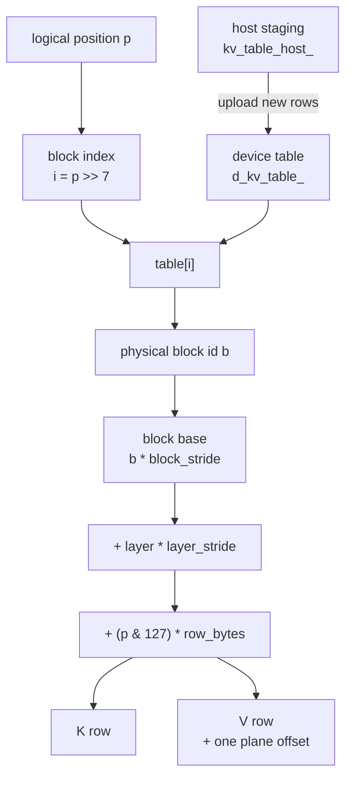

The executor's device-side `KvPageView` carries exactly the launch constants
the kernels need:

| field | meaning |
| --- | --- |
| `table` | device mirror of the session's `uint32` block table |
| `block_stride` | elements in one block across every layer |
| `layer_stride` | elements in one layer inside a block |
| `context_stride` | elements in one layer of the contiguous layout |
| `block_shift` | `log2(128) = 7` |

The paged row formula is:

```text
offset = block * block_stride
       + layer * layer_stride
       + (position & 127) * row_bytes
```

The table load is hoisted **once per 128-position block/tile**. That matters:
the measured paged decode path costs about +4 to +5.6% when the table is
resolved per position, but is within noise (and sometimes slightly faster) when
the lookup is hoisted per block. The kernels must not put a table load into the
inner position loop.

The pool is one allocation for both planes:

```text
K base = d_kv_pool_
V base = d_kv_pool_ + blocks * block_elements
block_elements = 128 * attention_layers * kv_dim
```

The pool is zeroed at creation so a capture that preserves rows before their
first write sees deterministic bytes, exactly like the old contiguous planes.

## 5. Block lifecycle and reference counts

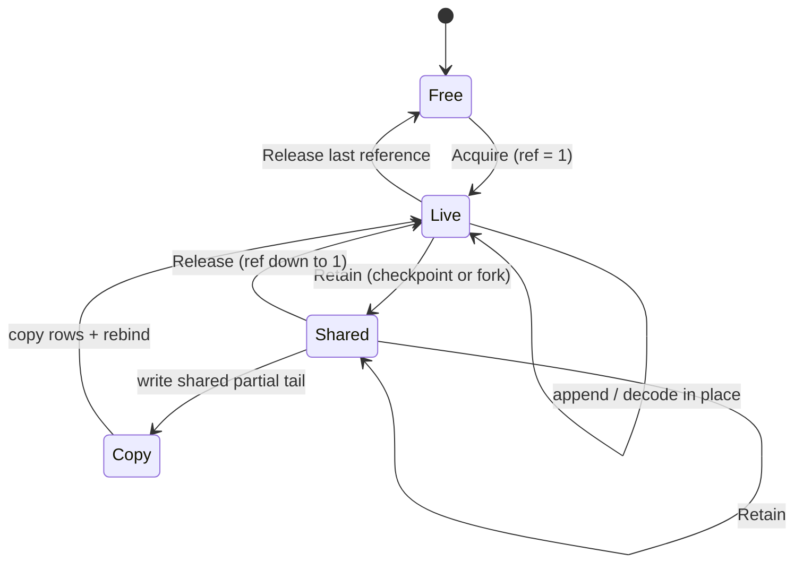

`KvBlockPool` is deliberately small and lock-free relative to the scheduler:
the model executor's single owner thread drives every call.

| operation | effect |
| --- | --- |
| `Acquire()` | take the oldest free id, set refcount 1, update high-water |
| `Retain(block)` | add one checkpoint/fork reference |
| `Release(block)` | drop one reference; refcount zero returns it to the FIFO free ring |
| `references(block)` | inspect the current count |
| `Snapshot()` | capacity/live/free/high-water for metrics and admission |

The free list is a ring: the block that has been free longest is reused first.
This gives a just-released prefix a short grace period in which a repeated
prompt can adopt its rows before a new capture overwrites them. There is no
compaction and no request-time device allocation.

**Full blocks are immutable.** Only the last, partial block of a prefix can be
shared and then written. That is why copy-on-write is bounded to one block
(3 MiB for Flash-Next), not a whole prefix.

## 6. Append and copy-on-write

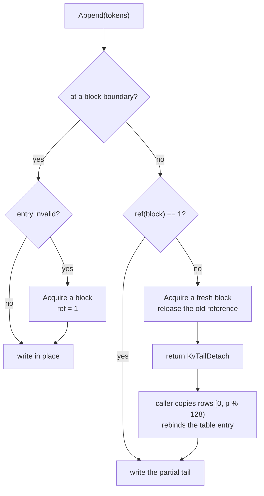

`KvBlockTable::Append` returns the number of positions actually appended. A
partial result is a normal, recoverable state: the pool is exhausted, or the
table reached capacity, and the caller keeps the table consistent and reports
progress.

`KvTailDetach` is the contract between the page table (host bookkeeping, no HIP
dependency) and the device executor:

| field | meaning |
| --- | --- |
| `required` | a device copy is needed before writing |
| `entry` | table entry that now points at the private copy |
| `source` | block currently holding the shared tail rows |
| `target` | fresh block to copy into |
| `rows` | positions to copy from the start of the block |

The same rule applies to `Truncate` and `ForkFrom`: they never move bytes
themselves. They report the copy, and the caller performs it on the device.

## 7. Fork, restore and shared prefixes

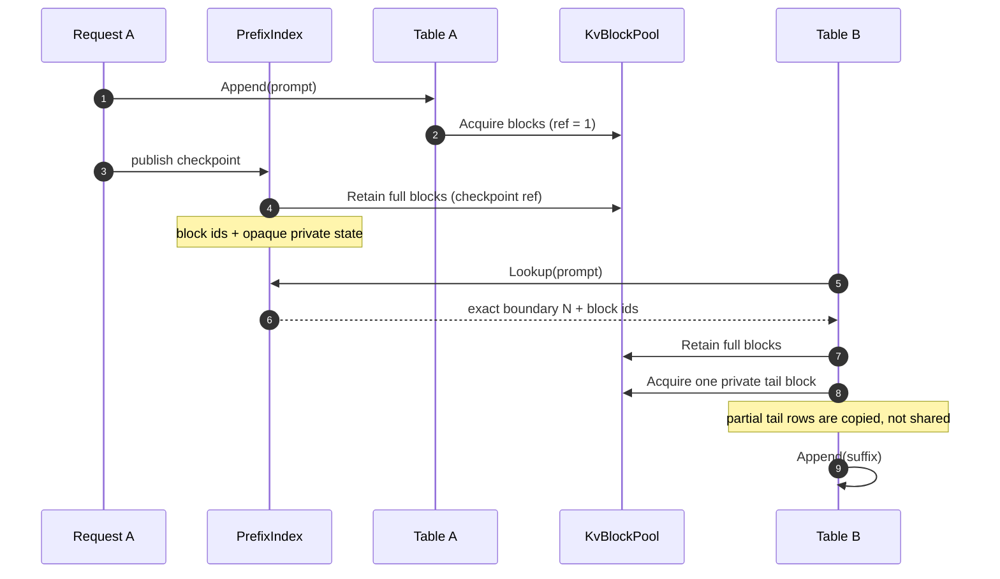

- `ForkFrom` requires an empty destination table. It retains every full block
  in the shared prefix and allocates a private block for the partial tail.
- A restore of a checkpoint uses `Adopt`/`AdoptSharedRows` only for ranges that
  are **128-token aligned**. The adapter validates every source block before
  adopting any; a failed validation leaves the destination table untouched and
  falls back to a row copy.
- A **live frontier** can lend its device rows directly. The restore receives
  the source's own device pointer and generation; a pointer/generation mismatch
  means the rows changed and the restore copies instead.
- Before a slot is invalidated or reset, `ReleaseAll` drops the session's table
  references and `RemapTable` starts a fresh table. An adopted share never
  survives into a new request.
- If a writer needs a shared **partial** block, the mutation guard preserves or
  retires the readers first, then the COW path above detaches the tail.

This is the difference between a checkpoint restore that copies a 100k-token
prefix and one that adopts 781 full blocks and copies only the final partial
block.

After an adoption the adapter clears `d_kv_table_rows_`, so the next execution
uploads the complete table. The host staging vector `kv_table_host_` stays
alive across the asynchronous copy and across captured graph replays.

### Mutation guard before overwrite

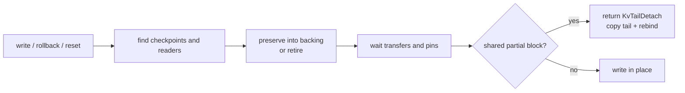

The guard order is fixed: find, preserve/retire, wait, then overwrite. In the
paged path the guard only has to deal with a **partial** block; full blocks are
immutable and are never overwritten. This is what keeps the worst-case
copy-on-write cost at one 3 MiB block.

## 8. Checkpoint record and cache structure

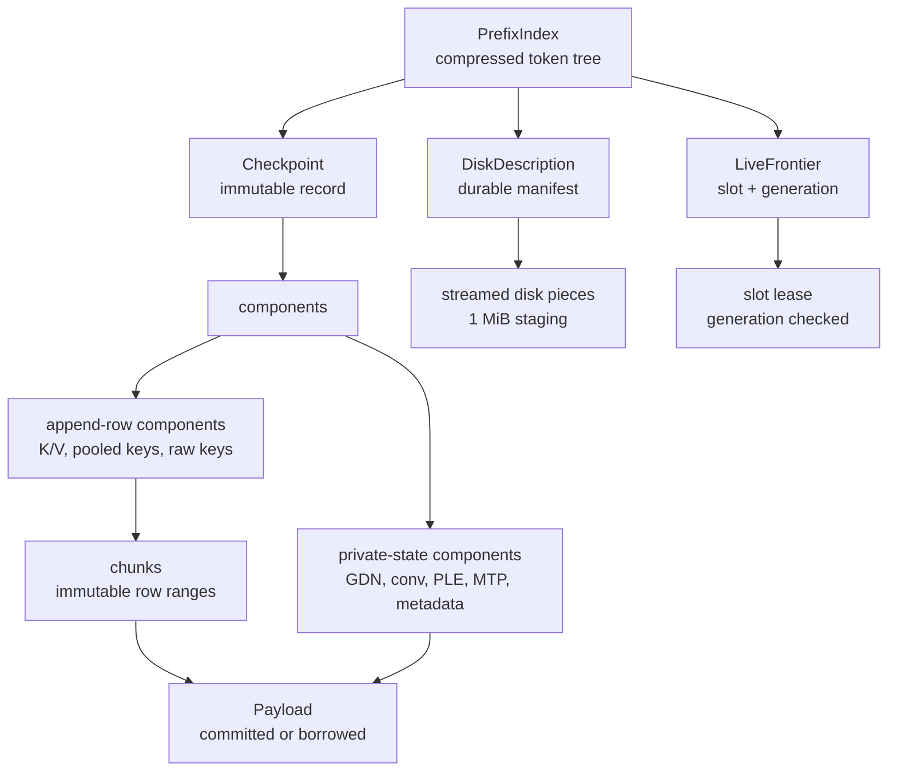

A checkpoint is not literally a K/V tensor copy. It is an opaque model-owned
snapshot with typed components:

| component class | examples | shared/paged? |
| --- | --- | --- |
| append rows | full-attention K/V, pooled keys, raw indexer keys | full K/V blocks can be adopted by reference |
| private state | GDN recurrent/convolution state, PLE history, MTP ring, metadata, logits | copied as opaque payload |
| private tail | the last partial block of a row component | always private to the checkpoint |

Reference ownership is split three ways:

- **checkpoint references** keep a chunk alive while a retained checkpoint
  needs it;
- **reader pins** keep it valid while a restore/transfer is reading;
- **persistence pins** keep it valid while a disk job is writing.

`ResourceLedger` accounts for the bytes by category: free/assigned/materialized
backing, private state, private tail, metadata and transfer staging. Eviction
drops the checkpoint owner; physical storage is freed only when the last
reader/persistence pin also releases.

The cache's selection rules are:

1. exact token-prefix match, with matching compatibility and input identity;
2. prefer a live frontier over a checkpoint at the same boundary (no restore);
3. otherwise use the deepest usable checkpoint;
4. among equal depths prefer live, resident, mixed, then durable;
5. a miss still reports the longest common prefix, but that is not a reuse
   boundary.

The canonical benchmark is deliberately **cold**: unique front-loaded nonces,
RAM cache off. It measures prefill/decode, not checkpoint reuse. Do not compare
its physical-token total with a cached/coalesced workload without labelling the
difference.

## 9. Shared-prefix scheduling

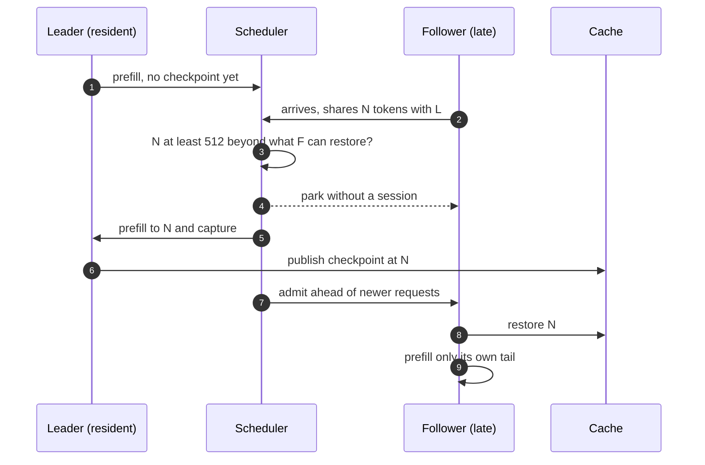

The wait is advisory and bounded:

- only when the shared prefix is at least **512 tokens longer** than what the
  follower could already restore;
- only while the leader has not prefilled past that position;
- only when the runner supports snapshots;
- at most once per request, and at most `sessions - 1` waiters;
- if the leader is cancelled or the checkpoint does not fit, the follower
  prefills by itself.

This is **not** request coalescing. Coalescing (`GUFO_REQUEST_COALESCE=1`)
shares one generated token stream between byte-identical greedy requests;
followers have no runner request and no KV. Shared-prefix waiting shares a
prefill checkpoint; each follower still owns a session and its own suffix.

## 10. Pool sizing and admission

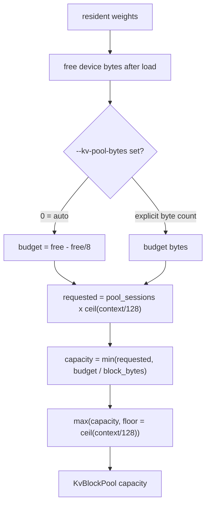

The floor is important: one full-context session must always remain
addressable, even when the byte budget is small. `--kv-pool-bytes off` keeps
that floor and reserves nothing beyond it; `--kv-pool-bytes 0` (the default)
uses the free-memory estimate; an explicit byte count is used as given.

**Admission is a different calculation.** The runner's resource claim charges
only the base state each resident session owns, not the full context and not
the KV rows it maps later. That is why a lazy pool raises the session count
substantially but still has a finite admission bound:

```text
runner admission: sessions * base_state_bytes <= free bytes * 0.75
actual pool:      live_blocks * block_bytes <= pool capacity
```

The first bound protects the execution states and leaves the 25 % reserve for
cache backing, transfer streams and allocator fragmentation; the second bound
controls in-flight KV. They are intentionally separate: a session owns its
block table and index, not the KV rows it maps later.

### Worked example: uncapped 96-session fit at 250k

| quantity | value |
| --- | ---: |
| context per session | 250,000 tokens |
| blocks per full context | 1,954 |
| Flash-Next block bytes | 3 MiB |
| one full-context K/V | about 5.86 GiB |
| 512 MiB requested pool, floored to one context | 1,954 blocks |
| base state per session | about 290 MiB |
| measured state capacity | about 36.6 GiB |
| uncapped auto fit after 25 % reserve | 96 |
| effective auto sessions (hard cap) | 64 |

The pool holds about **one full 250k context**, not 96. The uncapped fit is 96
sessions, but current builds hard-cap autoscaling at 64; each session is
admitted because it owns only about 290 MiB of base state, and KV blocks map
lazily from the shared pool as prompts and outputs grow. Medium-length chats
share the pool comfortably. If the pool does fill, admission holds new
requests and KV exhaustion defers a resident request instead of allocating
beyond the budget.

## 11. Invariants and source map

### Invariants

- One block table per session covers every full-attention layer and both K/V
  planes; there is no per-layer table.
- Full blocks are immutable. Only a partial tail is copied on fork or write.
- A table entry owns no memory; it names a pool block. The pool has no
  compaction and no device allocation after startup.
- A block is freed only when its live table, all checkpoints, readers and
  persistence pins release it.
- A checkpoint restore is exact-prefix only. A live frontier is preferred over
  a checkpoint at the same boundary.
- Private recurrent/indexer/MTP state is never paged; it is captured as opaque
  private state.
- Disk checkpoints serialize rows; block ids are device-local and cannot be
  persisted as pointers.
- Coalescing and shared-prefix caching are different mechanisms with different
  ownership and accounting.

### Code map

| concern | source |
| --- | --- |
| block size, pool, table, COW contracts | `src/models/qwen/kv_blocks.hpp`, `src/models/qwen/kv_blocks.cpp` |
| device row translation | `src/models/qwen/hip/detail/kv_page.hpp` |
| Flash-Next pool allocation and session tables | `src/models/qwen38_flash_next/kernels/rocm/executor.cpp` |
| Flash-Next capture/restore/adoption | `src/models/qwen38_flash_next/continuation_adapter.cpp` |
| prefix index and candidate selection | `src/cache/prefix_index.hpp` |
| checkpoint/chunk/payload ownership | `src/cache/checkpoint.hpp`, `src/cache/checkpoint.cpp` |
| slot leases and mutation guard | `src/cache/slot.hpp`, `src/cache/slot.cpp` |
| resource accounting | `src/cache/ledger.hpp`, `src/cache/ledger.cpp` |
| retention and cold gate | `src/cache/retention.hpp`, `src/cache/retention.cpp` |
| scheduler KV pressure and shared-prefix wait | `src/cli/serve/text_generation_scheduler.cpp` |
| design rationale and measurements | [paged KV design](cache-redesign/paged-kv.md), [cards 04](cache-redesign/cards/04-chunks-and-checkpoints.md), [06](cache-redesign/cards/06-slot-leases-and-mutation.md), [08](cache-redesign/cards/08-committed-backing-and-streams.md), [13](cache-redesign/cards/13-tiered-lookup-and-eviction.md) |

### Operational diagnostics

- `GET /metrics` exposes `gufo_kv_cache_usage_ratio`,
  `gufo_kv_limited_total` and `gufo_kv_deferred_total`; the legacy
  `llamacpp:*` names remain for llama.cpp-compatible dashboards.
- A text response's `usage.gufo.component_cache.global_kv_pool` reports
  `capacity_blocks`, `live_blocks`, `free_blocks`, `high_water_blocks` and
  `block_bytes`.
- `high_water_blocks` close to `capacity_blocks` means the workload actually
  needs the pool; a large gap means the configured context/session envelope was
  only a reservation.
- Pool exhaustion is not a crash: the page table stops appending, a partial
  block is preserved/detached, and the scheduler preempts a decoder with
  recompute when it cannot grant the prefill floor.
