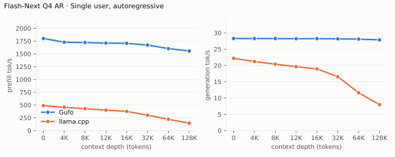
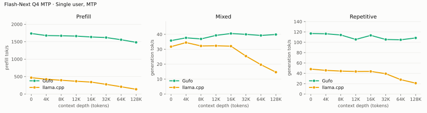
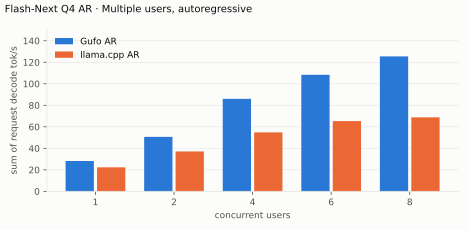
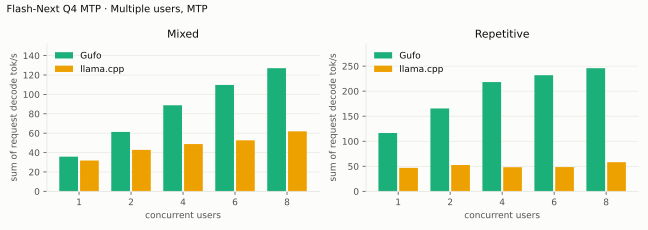
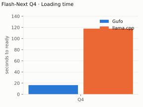
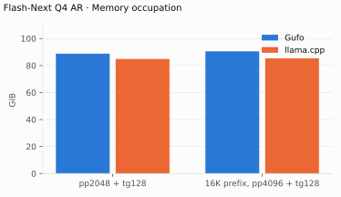

# Qwen3.8 Flash-Next benchmarks

AMD Strix Halo `gfx1151`, 128 GB unified memory. Unsloth `UD-Q4_K_XL` target
with shared-Q8_0 MTP; adaptive drafting. HTTP, greedy, thinking off.
Gufo `fec4759d` (October 18, 2026); llama.cpp `b11069` AR and `6fcaa16f` MTP
(September 22–23). Positive gain favors Gufo.
[Quality and measurement details](QUALITY.md#benchmark-method) · [Model identities](artifacts/model-identities.json)

## Single user, autoregressive

Approximately pp2048 / tg128; depth is the cached prefix in tokens.
Context capacities differ between engines; see the measurement details.

<!-- bench:single-ar -->
| Flash-Next Q4 AR<br>Depth (tokens) | Gufo pp (tok/s) | llama.cpp pp (tok/s) | Gain | Gufo tg (tok/s) | llama.cpp tg (tok/s) | Gain |
| ---: | ---: | ---: | ---: | ---: | ---: | ---: |
| 0 | 1801.01 | 489.59 | +267.9% | 28.29 | 22.20 | +27.4% |
| 4,096 | 1727.95 | 455.24 | +279.6% | 28.27 | 21.21 | +33.3% |
| 8,192 | 1721.41 | 428.85 | +301.4% | 28.27 | 20.40 | +38.6% |
| 12,288 | 1710.64 | 400.21 | +327.4% | 28.21 | 19.64 | +43.6% |
| 16,384 | 1706.86 | 375.89 | +354.1% | 28.25 | 18.95 | +49.1% |
| 32,768 | 1672.60 | 301.31 | +455.1% | 28.18 | 16.54 | +70.4% |
| 65,536 | 1602.93 | 221.94 | +622.2% | 28.09 | 11.62 | +141.7% |
| 131,072 | 1557.18 | 144.78 | +975.5% | 27.85 | 7.98 | +249.0% |
<!-- /bench -->



## Single user, MTP

pp is the highest measured rate per engine and depth across mixed/repetitive
text, including Gufo predictor catch-up.

<!-- bench:single-mtp -->
| Flash-Next Q4 MTP<br>Depth (tokens) | Gufo pp (tok/s) | llama.cpp pp (tok/s) | Gain pp | Gufo tg mixed (tok/s) | llama.cpp tg mixed (tok/s) | Gain mixed | Gufo tg repetitive (tok/s) | llama.cpp tg repetitive (tok/s) | Gain repetitive |
| ---: | ---: | ---: | ---: | ---: | ---: | ---: | ---: | ---: | ---: |
| 0 | 1734.96 ± 0.85 | 468.76 | +270.1% | 35.79 | 31.73 | +12.8% | 116.93 ± 0.10 | 48.12 | +143.0% |
| 4,096 | 1676.83 ± 1.73 | 423.79 | +295.7% | 37.64 | 34.48 | +9.2% | 116.41 ± 0.07 | 45.71 | +154.7% |
| 8,192 | 1669.91 | 394.98 | +322.8% | 36.91 | 32.20 | +14.6% | 114.08 ± 0.01 | 44.31 | +157.5% |
| 12,288 | 1660.54 ± 1.22 | 365.91 | +353.8% | 39.28 | 32.32 | +21.5% | 105.48 ± 0.15 | 43.53 | +142.3% |
| 16,384 | 1635.18 | 341.98 | +378.2% | 40.54 | 32.07 | +26.4% | 113.32 ± 0.23 | 43.66 | +159.6% |
| 32,768 | 1618.63 | 277.61 | +483.1% | 39.97 | 25.41 | +57.3% | 105.38 ± 0.17 | 39.28 | +168.3% |
| 65,536 | 1556.32 | 208.04 | +648.1% | 39.23 | 19.65 | +99.6% | 104.78 ± 0.21 | 27.75 | +277.6% |
| 131,072 | 1481.19 | 135.42 | +993.8% | 39.87 | 14.63 | +172.5% | 108.37 | 20.96 | +417.0% |
<!-- /bench -->



## Multiple users, autoregressive

Same pp2048 prose prompt as single-user d0, tg128, context 4096 per user.
All sessions prefilled before timed decoding; throughput sums individual rates.
llama.cpp re-evaluates its four-token checkpoint tail.

<!-- bench:multi-ar -->
| Flash-Next Q4 AR<br>Users | Gufo AR (tok/s) | llama.cpp AR (tok/s) | Gain |
| ---: | ---: | ---: | ---: |
| 1 | 28.24 | 22.34 | +26.4% |
| 2 | 50.66 | 37.08 | +36.6% |
| 4 | 86.01 | 54.82 | +56.9% |
| 6 | 108.34 | 65.34 | +65.8% |
| 8 | 125.48 | 68.79 | +82.4% |
<!-- /bench -->



## Multiple users, MTP

Same pp2048 mixed/repetitive prompts as single-user d0, tg128, context 4096
per user. All sessions prefilled before timed decoding; rates sum individual
request decode rates. C1 cross-checks the single-user table.

<!-- bench:multi-mtp -->
| Flash-Next Q4 MTP<br>Users | Gufo mixed (tok/s) | llama.cpp mixed (tok/s) | Gain | Gufo repetitive (tok/s) | llama.cpp repetitive (tok/s) | Gain |
| ---: | ---: | ---: | ---: | ---: | ---: | ---: |
| 1 | 35.74 | 31.77 | +12.5% | 116.50 | 46.93 | +148.2% |
| 2 | 61.30 | 42.79 | +43.3% | 165.50 | 52.57 | +214.8% |
| 4 | 88.77 | 48.78 | +82.0% | 218.12 | 48.23 | +352.2% |
| 6 | 109.74 | 52.59 | +108.7% | 231.85 | 48.51 | +377.9% |
| 8 | 127.02 | 61.92 | +105.1% | 245.81 | 58.13 | +322.9% |
<!-- /bench -->



## Loading time

C1, context capacity 262144, MTP. Cold target/sidecar files to HTTP readiness.

<!-- bench:loading -->
| Flash-Next Q4<br>Target | Gufo ready (s) | llama.cpp ready (s) | Gain |
| --- | ---: | ---: | ---: |
| Q4 | 16.42 | 117.83 | +617.6% |
<!-- /bench -->



## Memory occupation

C1, context capacity 133121, AR. Peak memory reported by HIP.

<!-- bench:memory -->
| Flash-Next Q4 AR<br>Workload | Gufo GiB | llama.cpp GiB | Gain |
| --- | ---: | ---: | ---: |
| pp2048 + tg128 | 88.78 | 84.84 | -4.4% |
| 16K prefix, pp4096 + tg128 | 90.53 | 85.31 | -5.8% |
<!-- /bench -->



## Batch scaling (November 2026)

Current build (AR, no MTP), `--sessions 32`, `--context 1024`,
`--prefill-chunk 16384`, 336-token unique prompts, 128 output tokens,
`--cache-ram-bytes off`, thinking off, one warmup plus two measured rounds per
level. `req` is the model-reported rate of one request, `agg` the rate over the
whole round (what a client sees), and `decode-phase` the aggregate output rate
divided by the non-prefill share of the round.

<!-- bench:concurrency -->
| Concurrency | req PP tok/s | req TG tok/s | agg PP tok/s | agg TG tok/s | agg total | prefill share | decode-phase | TTFT |
| ---: | ---: | ---: | ---: | ---: | ---: | ---: | ---: | ---: |
| 1 | 643.86 | 28.34 | 66.94 | 25.35 | 92.29 | 10.4% | 28.29 | 0.53 s |
| 2 | 639.19 | 22.12 | 97.82 | 37.15 | 134.97 | 15.3% | 43.86 | 1.03 s |
| 4 | 660.18 | 16.42 | 134.27 | 51.30 | 185.57 | 20.3% | 64.40 | 1.96 s |
| 8 | 669.61 | 11.57 | 173.00 | 66.10 | 239.10 | 25.8% | 89.13 | 3.86 s |
| 16 | 671.78 | 7.29 | 201.46 | 76.44 | 277.90 | 30.0% | 109.18 | 7.86 s |
| 32 | 666.35 | 4.33 | 217.79 | 83.54 | 301.33 | 32.7% | 124.10 | 16.07 s |
<!-- /bench -->

Per-request prefill is flat at 640-672 tok/s across the whole range, because one
prefill pass runs at a time; its share of the round therefore grows from 10.4%
to 32.7% while aggregate decode scales 25.35 -> 83.54 tok/s. Each doubling is
worth less: +46%, +38%, +29%, +16%, +8.4%. Run-to-run variance on the reference
host is 1-3%.

### 2026-11-05 re-measurement with the coalescing build

Same settings as the reference table (32-session server, context 1024,
prefill chunk 16384, 128 tokens, prompt repeat 6, cache off, 2 repetitions).
The request-coalescing path is default-off and the canonical prompts use
unique front-loaded nonces, so this is the unchanged decode path:

| Sessions | PP/s per stream (median, min-max) | PP/s total | TG/s per stream (median, min-max) | TG/s total | Sum | TTFT |
| ---: | --- | ---: | --- | ---: | ---: | ---: |
| 8 | 783.0 (776-795) | 185.86 | 12.14 (11.99-12.28) | 71.22 | 257.08 | 3.30 s |
| 16 | 789.8 (784-797) | 227.16 | 8.10 (8.03-8.29) | 86.19 | 313.35 | 6.72 s |
| 24 | 788.7 (783-796) | 231.80 | 5.69 (5.63-5.88) | 87.89 | 319.69 | 10.27 s |
| 32 | 793.7 (788-804) | 246.36 | 4.76 (4.67-4.98) | 93.11 | 339.47 | 13.81 s |

Sum deltas: c8 -2.29%, c16 +1.46%, c24 -0.70%, c32 -0.93% - all inside the
documented run noise (c8 is the +/-8% point; c16-c32 are 1-2%). The canonical
unique-nonce workload does not trigger coalescing or prefix reuse. The new
potential for shared-prefix batches is measured separately: the shared-prefix
c32 cache-off vs cache-auto run goes from 94.67 to 119.94 output tok/s
(+26.7%) and from 13.87 s to 0.223 s TTFT, while the physical-token total
falls because cached prefill is logged as zero. Details in
`artifacts/serving/batch-pp-tg-levers.md` §23.

Fresh request-coalescing on/off on the same four levels (sum tok/s):

| Sessions | Off | On | Delta |
| ---: | ---: | ---: | ---: |
| 8 | 255.76 | 258.10 | +0.91% |
| 16 | 305.98 | 308.02 | +0.67% |
| 24 | 321.13 | 323.67 | +0.79% |
| 32 | 342.00 | 343.47 | +0.43% |

The unique nonces mean no group forms; the on-arm difference is within noise
and is not a regression. On a genuinely identical 8/16/24/32 batch, the
coalesced arm is 2.89x / 5.02x / 7.16x / 9.08x faster in wall/output terms;
details and the physical-token caveat are in
`artifacts/serving/batch-pp-tg-levers.md` §24.

### Width curve

Same binary and settings, 336-token prompts:

<!-- bench:width -->
| Batch width | agg total tok/s | change | agg TG tok/s | req TG tok/s | prefill share | decode-phase | TTFT |
| ---: | ---: | ---: | ---: | ---: | ---: | ---: | ---: |
| 8 | 243.87 | - | 67.71 | 11.38 | 22.5% | 87.34 | 3.29 s |
| 16 | 312.87 | +28.3% | 86.05 | 8.06 | 28.7% | 120.64 | 6.72 s |
| 24 | 323.00 | +3.2% | 88.42 | 5.74 | 29.6% | 125.56 | 10.27 s |
| 32 | 342.76 | +6.1% | 94.01 | 4.82 | 31.4% | 137.05 | 13.82 s |
<!-- /bench -->

Per stream versus total, same run (one stream = one request; each session
carried two requests in two waves):

| Sessions | PP/stream (tok/s) | PP total | TG/stream (tok/s) | TG total | total |
| ---: | ---: | ---: | ---: | ---: | ---: |
| 8 | 783.9 (780.4-794.7) | 176.2 | 11.38 (10.70-12.11) | 67.7 | 243.9 |
| 16 | 791.1 (765.6-802.5) | 226.8 | 8.06 (7.99-8.21) | 86.1 | 312.9 |
| 24 | 793.0 (787.6-799.9) | 234.6 | 5.74 (5.67-5.94) | 88.4 | 323.0 |
| 32 | 792.0 (787.7-800.8) | 248.8 | 4.82 (4.74-5.05) | 94.0 | 342.8 |

`PP/stream` is the model-reported rate of one prefill pass and is flat across
widths because one pass runs at a time; `PP total` is prompt tokens over the
whole round, so it carries the decode share. `TG/stream` is one request's decode
rate; `TG total` is aggregate output over the round.

A confirmation run on the next morning (same binary, same settings) reproduced
16/24/32 sessions within 1.3% (308.84 / 321.96 / 342.65 total; 7.86 / 5.71 /
4.80 TG per stream; 224.3 / 233.6 / 248.9 PP total). The 8-session point came out
7.9% higher (263.12 vs 243.87, TG per stream 12.31 vs 11.38), so that point is
the least stable of the four; the 16-32 range is the reproducible part.

Post-reboot run with the relinked binary (2026-11-04T18:59). The earlier sweep
in this section measured 231.61 / 277.14 / 294.00 / 305.19 on the same settings;
the host later wedged in an amdgpu SVM deadlock, and the fresh boot is 10-13%
faster at equal settings with identical code paths. The width-32 gain is
therefore reported against a same-binary control rather than against that older
absolute: width 32 versus a c32 two-wave control (16 sessions) is **+11.26%
total** and **+15.48% decode-phase**, with the prefill share 3.07 points worse
(31.38% vs 28.31%), so it still misses the strict gate's second condition.

### Prefill cost model

A prefill pass costs `~0.285 s + t/1450` at context 2048 (`0.275 s + t/1501` at
context 1024): the fixed part is about one full 66 GB expert-weight read at the
240.76 GB/s DRAM ceiling, the per-token part is compute-bound at ~7 TFLOPS
(15% of the 47.9 TFLOPS fp16 peak). Two requests in one experimental cohort
pass measured 2 x 702 tokens in 1157/1077 ms (1213/1303 tok/s) against 945
tok/s for the serial model at that length, i.e. **+28-38% prefill throughput**;
batching is now automatic: the cohort cap is 32 and the actual size is
`min(32, prefilling queue depth)`. The 2026-11-06 fix reproduces the serial
stable-prefix chunk boundary in the batched path: a deterministic 256-prompt
check matches serial output 256/256 for cohort 8, 16 and 32, and at 1024×16
the automatic cohort takes 214.4 s instead of 416.3 s (TG 39.4 → 76.4 tok/s,
PP 233.5 → 453.3 tok/s). The cohort curve peaks at 32; 64 and 128 regress.
Prefix-cache checkpoints from batched prefill are not yet restored by the
component cache, so the measurements use cache off. See
[batch throughput levers](../../BATCH-THROUGHPUT.md#baseline-and-where-the-time-goes).

Raw artifacts and the full analysis live in
`artifacts/serving/batch-pp-tg-levers.md`:
`pp-tg-concurrency-1-32-ctx1024.json`,
`batch-levers-width-curve-ctx1024.json`, `prefill-c1-r6-ctx2048.json`.

The N1-N9 levers beyond A1-A4/B1-B4, their targets and their per-lever verdicts
are in [`N-LEVERS.md`](N-LEVERS.md) and the machine-readable
`artifacts/serving/n-levers-status.json`.
Width 32 is the only N-lever measured so far; the rest are blocked by the
amdgpu SVM deadlock described there.

## Auto sessions at 128k (2026-11-05)

This section retains the run from the build that still sized auto sessions by
the per-request **full-context** claim; it resolved 12 sessions at 128k. The
2026-11-06 build charges only per-session base state and resolves 150 at 128k
and 96 at 250k; see [auto sessions at 250k](#auto-sessions-at-250k-2026-11-06)
for the current sizing and load results.

This is a separate workload from the cold canonical table above and from the
cache/coalescing A/Bs. It measures a long-context production server with
`--sessions auto`, where the pool is resolved from measured state capacity
instead of a fixed count. The client was the bounded version of a streaming
OpenAI benchmark: one warmup request plus one measured round per level, unique
eight-hex nonce prefix on every prompt (so every prefill is a cache miss),
364 prompt tokens, 128 output tokens, temperature 0.7, and
`stream_options.include_usage`.

Server: release build, Qwen3.8 Flash-Next UD-Q4_K_XL, autoregressive (no MTP),
`--sessions auto --context 128000`, `--kv-pool-bytes 536870912` (the engine
rounds this up to one full-context session: 1000 blocks of 3 MiB) and
`--cache-ram-bytes 1073741824`. Auto resolved to **12 sessions**
(`event=auto_sessions value=12 policy=context-fit`); with that build this was
the measured ceiling at 128k, because 13 sessions already exceeded the
per-request full-context state claim. Thinking stayed at the model default.

Aggregate PP and TG are physical token sums divided by the round wall time:
`prefill_tokens` counts only executed prefill (a cache hit would count zero)
and `generated_tokens` counts emitted completion tokens. Every request in this
run missed the cache, so physical and logical prompt tokens are equal.

### Concurrency sweep

| Concurrency | Requests | Wall s | req PP tok/s | req TG tok/s | agg PP tok/s | agg TG tok/s | req/s | Fail |
| ---: | ---: | ---: | ---: | ---: | ---: | ---: | ---: | ---: |
| 1 | 8 | 39.05 | 852.6 | 28.8 | 74.9 | 26.2 | 0.20 | 0 |
| 2 | 8 | 26.27 | 880.2 | 22.6 | 111.3 | 39.0 | 0.30 | 0 |
| 4 | 8 | 18.73 | 878.2 | 16.9 | 156.1 | 54.7 | 0.43 | 0 |
| 8 | 16 | 29.72 | 880.5 | 11.4 | 197.1 | 68.9 | 0.54 | 0 |
| 16 | 32 | 54.96 | 884.6 | 9.4 | 213.1 | 74.5 | 0.58 | 0 |
| 32 | 64 | 109.84 | 883.6 | 9.1 | 213.1 | 74.6 | 0.58 | 0 |
| 64 | 128 | 214.68 | 885.2 | 8.9 | 218.2 | 76.3 | 0.60 | 0 |
| 128 | 256 | 431.83 | 883.8 | 8.7 | 216.9 | 75.9 | 0.59 | 0 |

All 520 measured requests returned HTTP 200 with `outcome=completed`; there
were no failures and no KV deferrals. At 364-token prompts the 3 GiB pool is
never exhausted, so this curve isolates scheduled concurrency, not deferral.

Aggregate decode saturates at about **76 tok/s from 16 clients** and aggregate
prefill at about **217 tok/s**. More concurrency past that point buys queueing,
not throughput: per-request TG falls from 28.8 tok/s at c1 to 8.7 tok/s at c128,
while aggregate TG stays flat. At c128 the server reported `queue_ms` and
`ttft_ms` of about **199 s**. The server still completed every request; a
non-streaming client with a 60 s timeout aborts on its own side.

The `TTFT` column of the original script is not usable with thinking enabled:
it starts its timer only at the first `delta.content`, while Flash-Next streams
reasoning in `reasoning_content` first. The 747 ms and 379 ms values at c64 and
c128 are artifacts of when thinking ended, not prefill latency. Use the
server's `ttft_ms` log field, or run with `reasoning_effort: "none"`.

### MTP comparison

Same 128k auto server, same prompts and client, with
`--speculative mtp --mtp-model .../mtp-Qwen3.8-Flash-Next-shared-Q8_0.gguf`.
The sidecar consumes state capacity, so auto resolved to **10 sessions** here.

| Concurrency | Requests | Wall s | req PP tok/s | req TG tok/s | agg PP tok/s | agg TG tok/s | req/s | Fail |
| ---: | ---: | ---: | ---: | ---: | ---: | ---: | ---: | ---: |
| 1 | 8 | 25.00 | 864.4 | 47.9 | 117.2 | 41.0 | 0.32 | 0 |
| 8 | 16 | 30.48 | 863.4 | 11.7 | 191.9 | 67.2 | 0.52 | 0 |
| 32 | 64 | 116.04 | 867.6 | 10.3 | 201.8 | 70.6 | 0.55 | 0 |

MTP raises single-stream decode from **28.8 to 47.9 tok/s (+66%)**, but the
aggregate stays on the same ~67-76 tok/s plateau as the autoregressive curve.
That matches the documented eight-row drafting gate: at wider cohorts the
proposal work no longer pays for itself end to end.

### Canonical confirmation

To check this client against the retained table, the same script ran on the
canonical server (`--sessions 32 --context 1024 --cache-ram-bytes off`, no MTP).
It uses 364-token prompts instead of the retained table's 336 and only one
measured round per level, so it confirms the shape rather than replacing the
table.

| Concurrency | agg PP tok/s | agg TG tok/s | agg total | req/s | Fail |
| ---: | ---: | ---: | ---: | ---: | ---: |
| 1 | 73.4 | 25.7 | 99.1 | 0.20 | 0 |
| 8 | 191.9 | 67.1 | 259.0 | 0.52 | 0 |
| 16 | 222.6 | 77.9 | 300.5 | 0.61 | 0 |
| 32 | 242.8 | 85.0 | 327.8 | 0.66 | 0 |
| 64 | 243.0 | 85.0 | 328.0 | 0.66 | 0 |

The c32 point reproduces the documented range (83.5-94.0 aggregate TG and
248.8 aggregate PP): **85.0 TG and 242.8 PP** here. At c64 the extra requests
queue behind the same 32 sessions, so aggregate throughput stays at the c32
plateau and wall time scales with the request count.

### Measurement caveats

- The original script's `CONCURRENCY = range(1, 1025)` with
  `n = max(8, 2 * c)` would issue **1,048,568 requests**. The runs above use a
  bounded ladder (1-128 for the auto sweep, 1-64 for the canonical check) with
  the script's per-request logic unchanged.
- `httpx.Limits(max_connections=64)` caps effective parallelism at 64. The c128
  level was therefore run with the connection cap raised to 128; levels up to
  64 are unaffected.
- A client timeout at high concurrency is a client-side abort, not a server
  failure. Retained server logs for these runs show HTTP 200 and
  `outcome=completed` for every request and no 5xx responses.

## Auto sessions at 250k (2026-11-06)

The 2026-11-06 build changed the auto contract: the pool is sized from the
per-session **base state** (KV block table, index and recurrent state) instead
of the full context, with a 25 % reserve for cache backing, transfer streams
and allocator fragmentation. The shared paged-KV rows are charged only when a
request maps them, and admission compares each request's prompt plus requested
output against the pool's free blocks and outstanding reservations.

Measured server: release build, Qwen3.8 Flash-Next UD-Q4_K_XL, autoregressive,
`--sessions auto --context 250000`, `--kv-pool-bytes 536870912` (floored to one
full-context session: 1,954 blocks of 3 MiB = 250,112 tokens),
`--cache-ram-bytes 1073741824`. The model's native context is 262,144, so
250,000 needs no YaRN. Startup logged:

```text
event=auto_sessions value=96 policy=base-state-fit
base_state_bytes=303750164 state_capacity_bytes=39277969408
shared_kv_tokens=250112
load_completed ... sessions=auto(96) context_tokens=250000
```

The same build resolves **150 sessions at 128k** (`base_state_bytes=210054164`,
`state_capacity_bytes=42278993920`, `shared_kv_tokens=128000`). Both counts
exceed the former 32-row control; the hybrid plan fills up to 96 or 150 rows
and the scheduler serves any further sessions in later waves. `/v1/models`
reports `context_length=250000`.

Two bounded loads used unique nonces (so every prompt is a cache miss) and
non-streaming requests:

| Workload | Requests | Concurrency | Prompt tokens | Output tokens | Wall s | p50 s | p95 s | Fail |
| --- | ---: | ---: | ---: | ---: | ---: | ---: | ---: | ---: |
| Short prompts, 32 output | 120 | 120 | 8,032 | 3,584 | 53.37 | 36.25 | 53.03 | 0 |
| ~3k prompts, 16 output | 100 | 100 | 306,093 | 1,600 | 238.59 | 200.08 | 238.10 | 0 |

The short burst made the scheduler grow from 1 to 96 residents in one step and
return to 1 when the queue drained. Every request returned HTTP 200. The long
load put **306,093 prompt tokens** through a pool whose full capacity is
250,112 tokens; the pool high-water mark was **1,675 of 1,954 blocks**
(214,400 of 250,112 tokens), so admission held the over-subscribed arrivals
queued and released them as blocks became free. There were **no 5xx responses,
no request-state claim failures and no KV-degradation aborts**. The single
`kv_admission_deferred`/`kv_exhaustion_degraded` case is covered by the
scheduler unit test, which blocks an arrival against a synthetic shared pool
and resumes it when blocks are freed.

## Wide decode plans (2026-11-06)

The 32-row ceiling was a compile-time cohort bound, not a kernel limit. The
2026-11-06 experiment raises the executor capacity to **256 rows**, advertises
plans 2..256, and lets the scheduler pick the widest plan the resident cohort
can fill. Above 64 rows the routed Q4_K expert projection is split into
qualified 64-row launches; the dense, attention and shared-expert work uses the
full plan width. `GUFO_DECODE_MAX_ROWS` narrows the advertised ceiling for A/B
runs.

### Width qualification

256 sessions, 4k context, 4 GiB KV pool, unique prompts (all cache misses),
256 requests with 128 output tokens, one measured round per width. `TG` and
`PP` are the client-observed aggregate physical token rates over the round.

| Rows | Wall s | agg TG tok/s | agg PP tok/s | Fail |
| ---: | ---: | ---: | ---: | ---: |
| 32 | 157.43 | 76.5 | 154.3 | 0 |
| 64 | 149.50 | 80.7 | 162.5 | 0 |
| 96 | 144.09 | 81.5 | 168.7 | 0 |
| 128 | 145.13 | 82.1 | 167.4 | 0 |
| 160 | 144.75 | 82.1 | 167.9 | 0 |
| 192 | 142.95 | 82.5 | 170.0 | 0 |
| 224 | 142.22 | 83.3 | 170.9 | 0 |
| 256 | 141.26 | 84.8 | 171.9 | 0 |

The gain is monotonic but shallow: the 64-row step gives most of it, 96-224
add 1-3 %, and 256 adds another ~2 %. Wider plans also raise p50 latency
because a cohort waits for more prefills before its first decode wave.

### 1024 concurrent requests

Same 256-session/8k server, unique prompts, cache off, 1024 requests. The
32-row run uses the 32-row control; the 256-row run uses the hybrid plan.

| Rows | Output | Wall s | agg TG tok/s | agg PP tok/s | Fail |
| ---: | ---: | ---: | ---: | ---: | ---: |
| 32 | 32 | 574.00 | 56.8 | 169.2 | 0 |
| 256 | 32 | 533.82 | **61.0** | 181.9 | 0 |
| 32 | 16 | 437.74 | 37.4 | 222.0 | 0 |
| 256 | 16 | 436.83 | 37.5 | 222.4 | 0 |

At 32 output tokens, 256 rows reduce wall time by **7.0 %** and raise total TG
by **7.4 %**. At 16 output tokens the run is prefill-dominated and the
difference is noise (37.5 vs 37.4 tok/s); the plan-width gain is a decode-work
lever, not a prefill lever. The later wide MoE dispatch and GDN state writeback
supersede the 16-output row: **144.4 s / 7.09 requests/s / 113.5 TG / 673.2
PP** (see
[2026-11-07](#wide-moe-dispatch-and-gdn-state-writeback-2026-11-07)).

### Correctness and production hybrid

A deterministic run (temperature 0, top-k 1, reasoning off, 8 output tokens,
256 fixed prompts) produced **256/256 identical content strings** at 32 and
256 rows. The production auto path uses the same hybrid: on the 250k server it
resolved 96 sessions and served 120 short requests with plans `w96`/`w83` in
48.28 s versus 52.76 s for the 32-row run, with 120/120 HTTP 200. The 128k auto
path resolves 150 sessions and therefore advertises up to 150 rows; short
contexts use the full 256.

### Cohorts for TG (2026-11-06)

Automatic prefill cohorts also synchronize decode waves. At 1024x32 the serial
prefill run decoded in ~31-row batches, while the cohort path decoded 256 rows
and raised aggregate TG from 56.6 to 99.9 tok/s; wall fell from 575.0 to
326.8 s and TTFT p50 from 288 to 119 s. With automatic prefill but the decode
ceiling fixed at 32 rows, TG is 94.4 tok/s, so the 256-row decode cohort itself
adds **5.8 % TG**. A decode-dominated run (256 requests x 128-token budget, ~12k generated tokens) gives
68.5 -> 110.0 TG (+60.6 %), 142.4 -> 225.1 PP and TTFT 106 -> 25 s.

Per-request decode speed falls (0.7 vs 4.4 tok/s at 1024x32) because 256
streams share the GPU; aggregate TG, wall and TTFT improve. The trade is
explicit: wide decode cohorts optimize aggregate TG, not per-stream latency.
The production 250k auto server sizes its decode assembly to 96 sessions.

### Decode tile ladder (2026-11-06)

Decode projections now use the MMVQ dispatcher's full 1-32 row waves and the
16/32/48-token matrix kernel instead of pre-splitting at eight rows. At
`8k+1` ready rows the scheduler defers one row to the next step so the pass
runs 8/16/24/32 full tiles. Reproduced dips at 9/17/25/33 disappear:

| Concurrency | Before PP/s | After PP/s |
| ---: | ---: | ---: |
| 9 | 209.9 | 211.7-214.1 |
| 17 | 249.6 | 259.2 |
| 25 | 261.9 | 275.9 |
| 33 | 265.5 | 283.2 |

The 1024x16 reference improves to 209.9 s / 78.1 TG / 462.9 PP with 1024/1024
HTTP 200, and the deterministic 256-prompt check is 256/256.

### Wide MoE dispatch and GDN state writeback (2026-11-07)

Four alternating 2x2 A/B runs at context 4096, `--sessions 256`, unique prompts,
cache off. Each row is the aggregate of two runs per arm; the deterministic
256-prompt check is 256/256 for every adopted change. The complete catalog and
per-measure status are in [BATCH-THROUGHPUT](../../BATCH-THROUGHPUT.md) #25,
#28 and #51.

Wide MoE dispatch (#28). The 256-row benchmark routing collapses onto the same
ten experts (`distinct=10`, top=256), so the eight-token GEMV groups read each
hot expert's weights once per group. Wide plans now use the compacted
expert-matrix route, with the deferred epilogue settled before the batch
combine:

| Workload | Before | After | Delta |
| --- | ---: | ---: | ---: |
| 1024x16 | 210.2 s / 78.0 TG / 462 PP | 177.0 s / 92.6 TG / 549 PP | -15.8 % wall, +18.7 % TG |
| 256x128 | 103.5 s / 114.3 TG | 81.0 s / 145.8 TG | -21.7 % wall, +27.5 % TG |

Wide expert tiles (#25). The 64-row down and 128-row gate/up buckets replaced
the 16-row decode tiles; 1024x16 improved from 176.28 to 174.59 s
(92.95 -> 93.85 TG) and 256x128 from 145.0 to 149.0 TG.

GDN state writeback (#51). The BF16 recurrent state was written as 32 scalar
two-byte stores per thread at a 64-byte lane stride; it now uses four 16-byte
stores with the same round-to-nearest-even encoding:

| Workload | Before | After | Delta |
| --- | ---: | ---: | ---: |
| 1024x16 | 174.78 s / 93.75 TG / 555.6 PP | 156.48 s / 104.7 TG / 621.1 PP | -10.5 % wall, +11.7 % TG |
| 256x16 | 43.71 s / 93.7 TG | 39.52 s / 103.7 TG | -9.6 % wall, +10.7 % TG |

The #51 confirmation run was 157.2 s / 104.2 TG / 618.3 PP at 1024x16. Peak
output is unchanged: completion-token totals match the control arms, and the
only store change is the transaction width.

### Wide Q8 projections on the W8A8 route (2026-11-07)

The Q8_0 projections used the 32-row MMVQ preq tiles. At 256 rows each weight
block was re-read eight times, including the 151k x 2560 vocabulary head.
`DenseBatch` now sends Q8_0 rows above 48 through the W8A8/F16 Dense route,
which tiles the activations over wider blocks and reuses each weight block
across more token rows. Rows up to 48 keep the MMVQ tiles.

| Workload | Before | After | Delta |
| --- | ---: | ---: | ---: |
| 1024x16 | 155.4 s / 105.4 TG / 625 PP | 145.3 s / 112.8 TG / 668 PP | -6.5 % wall, +7.0 % TG |
| 256x128 | 64.1 s / 184.3 TG | 57.1 s / 208.0 TG | -10.9 % wall, +12.8 % TG |
| 256x16 | 38.9 s / 105.4 TG | 37.0 s / 110.7 TG | -4.9 % wall, +5.0 % TG |

The 1024x16 arm moves from 6.59 to 7.05 requests/s; the shipped binary's
confirmation run is **144.4 s / 7.09 requests/s / 113.5 TG / 673.2 PP**. The
deterministic 256-prompt check is 256/256. At 64 rows x 128 tokens the route
is neutral per token (157.6 vs 157.5 aggregate TG), so no small-batch
regression was introduced.
